# Developer guide: trunk + release branches

## Who this is for

Use this guide when the repository ships **numbered builds that consumers pin** — you already have `release/X.Y` branches, or you will cut them. The same branch layout, fix path, and tagging rules apply in every such repository. Version numbers differ per repository; the method does not.

If the repository only ever deploys the tip of `main`, you do not need release branches or backports. Fix on `main` and stop. That case is outside this guide.

**The version numbers in the examples (`1.4`, `1.5`, `1.6`) are stand-ins.** A repository can keep several older minors at once — `release/1.3`, `release/1.2`, and so on. Release branches **stay open**; leaving support means you stop patching that line, not that you delete the branch. Read every `1.4` / `1.5` as “the lines that currently qualify,” and substitute the real `X.Y` you are patching. How far back a fix goes is the support window in [section 3](#which-lines-still-receive-the-fix).

## Start here

| I need to… | Go to |
| --- | --- |
| Know which situation I’m in | [§7 Find your situation](#7-find-your-situation) |
| Ship a feature or a one-line fix today | [§5 A normal day](#5-a-normal-day) |
| See the whole map in one table | [§10 Cheat sheet](#10-cheat-sheet) |
| Copy a fix onto a release branch | [§6 The backport recipe](#6-the-backport-recipe) |

---

## 1. What this is

Customers install a numbered build and upgrade on their own schedule, so more than one build of a component is live. This is the GitHub process that lets a team finish one of those builds, start the next, and still patch an older one: the same daily work in every repo that uses this model; this release and the next moving at the same time; a patch that stays a patch; later releases that already contain the fix because it landed on `main` first; and a tag that names one ship forever.

### Principles

1. **One trunk.** `main` always holds the newest unreleased work. Feature work lands here.
2. **A release branch per minor you ship.** When a version is ready to freeze, cut `release/X.Y` from `main`. That branch is where `X.Y` is stabilized and later patched. `main` stays open. The release branch stays open after support ends; you simply stop opening normal backports onto it.
3. **Fix on the trunk, copy onto the release branch, tag the ship.** What customers install is a tag (`v1.4.0`, `v1.4.1`), not the moving tip of `main`.

A fix is written once, on `main`, and then copied onto each release branch that still has the bug and still qualifies for that fix. The copy is a cherry-pick: a new commit with a new SHA. The release branch is never merged back into `main`, and release branches are never merged into each other. Version bumps and changelogs stay on the release branch they belong to.

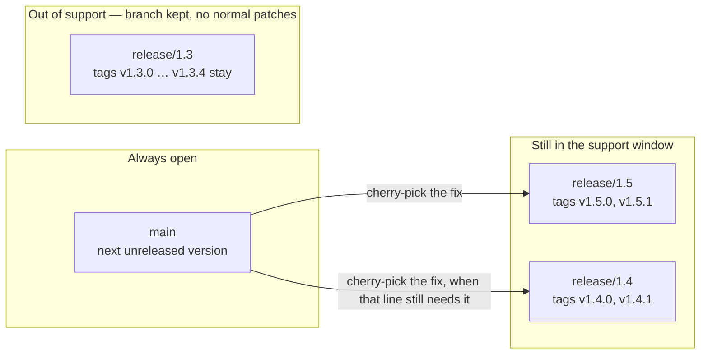

The same rules, as history. One fix becomes two commits, and `main` keeps moving.

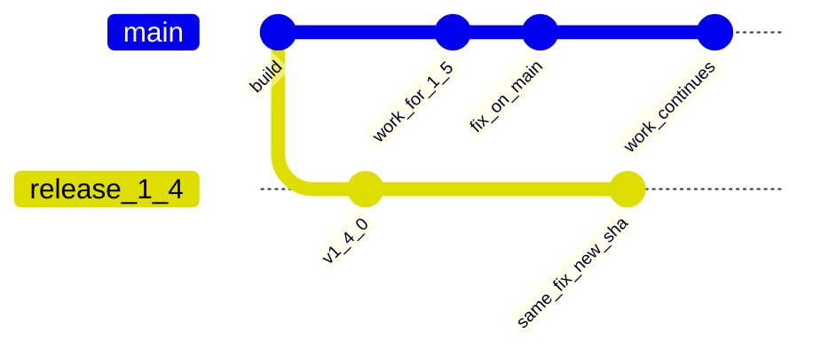

In that diagram, `release_1_4` is the real branch `release/1.4`. `fix_on_main` and `same_fix_new_sha` are the same change and different commits. After the copy, both lines contain the fix, and `main` has moved on.

---

## 2. The words on the pull request

| Word | What it means here |
| --- | --- |
| `main` | The next version. Feature work lands here. Product fixes land here first. |
| `release/1.4` | The maintenance line for every `1.4.x` tag. The branch stays after 1.4 leaves support; only the patch window closes. |
| Tag `v1.4.2` | The exact commit we shipped as 1.4.2. Immutable. A GitHub Release is created from it. |
| Feature branch | A short-lived branch from `main`, named `feature/<thing>` or `fix/<thing>`. |
| Backport | A cherry-pick of a `main` commit onto a release branch, opened as its own pull request. Branch name: `backport/<thing>-1.4`. |
| Forward-port | The reverse copy, used only when a fix was merged on a release branch before it reached `main`. |
| Release-only commit | A version bump, changelog, or note that belongs to that line. It stays on the release branch. |
| Product fix | A change in behavior a customer can observe. It belongs on `main` and on every supported line that still has the defect. |

`main` and every `release/*` branch are protected. A push straight to them is rejected. Every change is a pull request, including a one-line backport and a version bump.

**Merge policy.** Squash-merge into `main` and into every `release/*`. Cherry-pick that one merge commit. Do not use a merge commit or rebase-merge on those branches unless the repository has documented a multi-SHA cherry-pick path. If you must cherry-pick several commits, apply them oldest to newest — never the GitHub merge commit.

There is no `develop` branch and no `hotfix/*` branch type. A hotfix is a normal fix pull request, plus a backport onto the release branch that needs it.

---

## 3. Rules

1. Start feature work from `main`, and open the pull request against `main`.
2. When `main` still has a defect, land the fix on `main` first.
3. Cherry-pick **that** `main` **commit** onto each supported release branch that still has the defect. Newest release branch first. Each backport is its own pull request.
4. Leave version bumps and changelogs on the release branch that is about to be tagged.
5. Put the tag on the release-branch commit you are shipping. Leave the tag on that commit.
6. Keep `release/X.Y` after that line leaves support. Stop opening normal backports onto it; do not delete the branch.
7. Treat a pull request whose file list is the whole tree as the wrong branch. A backport changes the same few lines as the original fix.

### Which lines still receive the fix

Before you open backports:

1. List the release branches that exist: `git fetch origin && git branch -r | grep 'origin/release/'` (or GitHub → **Branches** → `release/`). Branches stay; the list can include lines that are already out of support.
2. Apply this table only to lines that still **qualify** for this defect. Existence of `release/1.2` does not mean 1.2 gets every fix.
3. If severity (normal vs security/critical) or “does this older line still qualify?” is unclear, ask the **release owner** before opening a backport. Do not open an older-line patch “while you are here.”

The examples that only name 1.4 and 1.5 are the common case of “current + previous,” not a hard limit on how many `release/*` branches a repo may keep.

| Line | Normal bug | Security, or a critical defect that cannot wait for an upgrade |
| --- | --- | --- |
| The minor customers are expected to run, and a minor that is frozen but not tagged yet | Yes | Yes |
| The one minor before that | No. Ship the fix on the newer line. The customer upgrades. | Yes |
| Anything older (`1.3`, `1.2`, …) | No | No, unless a release owner explicitly reopens that line |

On an NMM repository the “line” in that table is the **bundle** minor (`NMM 1.5` vs `NMM 1.4`). The manifest for that bundle names the component branch. Critical means an S1, or an S2 that cannot wait for an upgrade. Support sets severity. See [DEVELOPMENT_LIFECYCLE.md](./DEVELOPMENT_LIFECYCLE.md).

Newest first, in one picture. A customer who upgrades must not walk back into the bug.

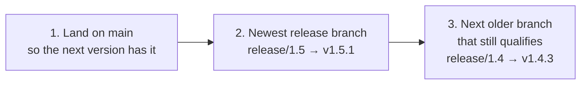

If you publish `v1.4.3` with the fix and forget `release/1.5`, a customer who then upgrades from 1.4.3 to 1.5.0 gets the bug back. Landing on 1.5 before you tag 1.4.3 closes that hole.

---

## 4. Who does what

| Action | Who |
| --- | --- |
| Feature pull request into `main` | The developer who owns the work |
| Fix pull request into `main`, then the backport pull requests | The developer who owns the fix |
| Decide which lines still qualify when severity or window is unclear | Release owner |
| Create `release/X.Y` | Release owner, or a maintainer they ask |
| Version bump and changelog on the release branch | Release owner |
| Annotated tag and GitHub Release | Release owner |
| Mark a line out of support (stop normal patches; leave the branch) | Release owner |

If you own the fix, you own the backport pull requests. You do not tag, and you do not bump the version inside the fix.

---

## 5. A normal day

Two days cover most weeks. The first never touches a release branch. The second touches one.

### 5.1 Build day — a feature for the next version

**At this moment.** Customers run `v1.4.0` from `release/1.4`. The next version is 1.5, and it lives only on `main`. `release/1.5` does not exist yet. You are adding CSV export of invoices. That behavior is 1.5 work.

You will not open `release/1.4`. CSV export is not a 1.4 patch.

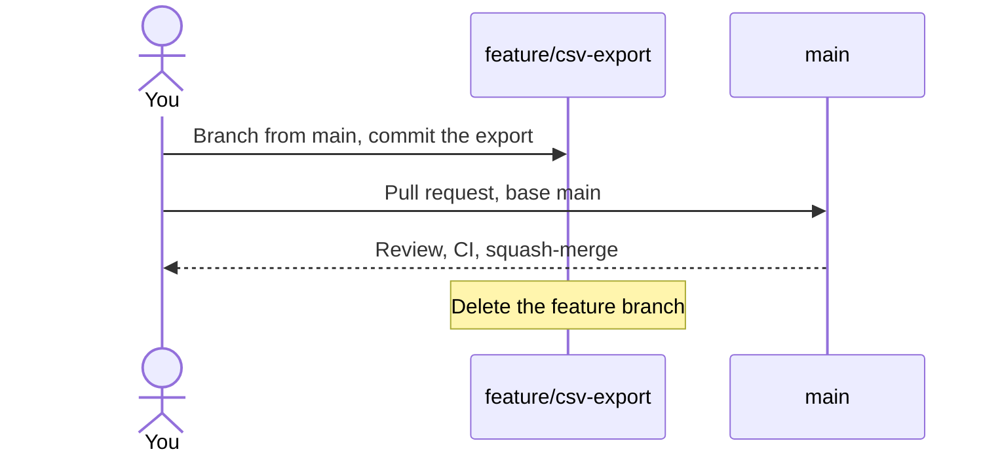

1. Update `main`.
   ```bash
    git fetch origin
    git switch main
    git pull origin main
   ```
2. Branch from that tip.
   ```bash
    git switch -c feature/csv-export
   ```
3. Make the change. Leave the version file and `CHANGELOG.md` alone. The release owner sets the version when `release/1.5` is cut.
4. Commit and push.
   ```bash
    git add -A
    git commit -m "Add CSV export of invoices"
    git push -u origin feature/csv-export
   ```
5. Open the pull request on GitHub.
   - If a banner says **Compare & pull request**, click it.
   - Otherwise **Pull requests → New pull request**.
   - **base:** `main`. **compare:** `feature/csv-export`.
   - Title: `Add CSV export of invoices`.
   - In the body, say what a reviewer should try.
   - Create the pull request.
6. Let CI finish. Answer review on this branch. If `main` has moved and GitHub offers **Update branch**, use it.
7. The reviewer squash-merges. Delete `feature/csv-export` when GitHub offers.

**You are done.** There is no tag, no backport, and no release branch. `main` now contains CSV export. It will ship in 1.5, whenever that line is cut.

The same steps are a bugfix that only the next version needs. Name the branch `fix/<thing>` and stop after the merge to `main`. You backport only when a supported release branch still has the defect.

### 5.2 Fix day — customers are on 1.4, and 1.5 is still only on `main`

**At this moment.** Same as the build day: `release/1.4` is the line customers run, latest tag `v1.4.0`. `main` is 1.5 and is not tagged. `release/1.3` exists and accepts security and critical fixes only.

QA reports: an invoice with no tax code crashes the total. You reproduce it on `v1.4.0` and on `main`. It is a normal product bug on the current line, so 1.4 gets a patch. 1.3 does not.

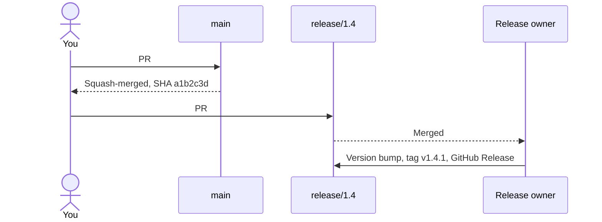

1. Branch from `main` and fix it there.
   ```bash
    git fetch origin
    git switch main
    git pull origin main
    git switch -c fix/null-tax
   ```

    The change on `main` is the real fix, aimed at the code `main` has today:
2. Push and open the pull request. **base:** `main`. Title: `Fix crash when tax code is null`.
3. On that pull request, add the label `backport-to-release/1.4`. The label records where the fix must be copied. It is a reminder, not a queue — you still open the backport yourself.
4. After it merges, copy the SHA of the commit that landed **on** `main`.
   - Squash merge: open the merged pull request and use the squash commit SHA. Call it `a1b2c3d` in this guide.
   - From a terminal: `gh pr view 431 --json mergeCommit --jq .mergeCommit.oid`
   - That SHA is the one you cherry-pick. The commits that used to be on `fix/null-tax` are not on `main` after a squash.
5. **Same sitting as the main merge:** open every backport pull request (a draft is fine) before you walk away. A merged `main` fix with a `backport-to-release/X.Y` label and no open backport for that line is unfinished work.
6. Follow [the backport recipe](#6-the-backport-recipe) onto `release/1.4`.
   ```bash
    git fetch origin
    git switch -c backport/null-tax-1.4 origin/release/1.4
    git cherry-pick -x a1b2c3d
    git push -u origin backport/null-tax-1.4
   ```

    `-x` adds `cherry picked from commit a1b2c3d` to the message, so the next person can find the original.
7. Open the backport pull request with **base:** `release/1.4` and **compare:** `backport/null-tax-1.4`. Title: `[1.4] Fix crash when tax code is null`. Body:
   ```text
    Backport of #431.
    Cherry-pick of a1b2c3d.
   ```
8. **Files changed** shows the tax-code fix and nothing else. CI runs. A reviewer merges it.
9. Stop. Tell the release owner #432 is merged. They bump 1.4.0 → 1.4.1, tag `v1.4.1`, and publish the GitHub Release. Those steps are [section 8.7](#87-version-bump-and-changelog) and [section 8.8](#88-tag-the-build-and-publish-the-github-release).

`main` already has the fix, so 1.5 will contain it on the day `release/1.5` is cut. You do not merge `release/1.4` into `main` to “bring the fix back.”

---

## 6. The backport recipe

Use this every time a commit on `main` must also exist on a release branch. Repeat it once per release branch. Always cherry-pick the `main` **SHA**, not the SHA of a previous backport. A previous backport may contain conflict resolutions that belong only on that newer line.

### 6.1 Local branch

```bash
git fetch origin
git switch -c backport/<short-name>-1.4 origin/release/1.4
git cherry-pick -x <sha-on-main>
```

Before you push, look at the commits you are about to add:

```bash
git log --oneline origin/release/1.4..HEAD
```

You want **one** commit. Then:

```bash
git push -u origin backport/<short-name>-1.4
```

### 6.2 The pull request on GitHub

GitHub’s banner after a push assumes **base:** `main`. Change it before you create the pull request.

| Field | Value |
| --- | --- |
| base | `release/1.4` (the line you are patching) |
| compare | `backport/<short-name>-1.4` |
| title | `[1.4] <same summary as the main pull request>` |
| body | `Backport of #<main PR>.` and the SHA |

From a terminal, the base has to be explicit or `gh` also targets `main`:

```bash
gh pr create --base release/1.4 --head backport/null-tax-1.4 \
  --title "[1.4] Fix crash when tax code is null" \
  --body "Backport of #431. Cherry-pick of a1b2c3d."
```

### 6.3 Two backports that look openable and are not

**Example 1 — the base dropdown was left on** `main`**.**

You cherry-picked correctly, then clicked the yellow banner. The pull request says `backport/null-tax-1.4` → `main`. Merging it would drop a 1.4 commit onto the 1.5 line, and it would not patch 1.4 at all.

Close it without merging. Open a new pull request and set **base:** `release/1.4`. The branch itself can stay.

**Example 2 — the branch was cut from** `main`**, so the diff is the whole release.**

`git log origin/release/1.4..HEAD` lists dozens of commits. **Files changed** is most of the repository: 1.5 features, plus your fix. GitHub is offering to merge `main` into `release/1.4`.

Close that pull request. Delete the bad branch and start [6.1](#61-local-branch) again from `origin/release/1.4`. The new **Files changed** tab matches the original fix: a file or two, not the tree.

### 6.4 Cherry-pick stopped

| Git says | What you do |
| --- | --- |
| It applies cleanly | Push and open the pull request. |
| Conflict markers | [Section 8.5](#85-the-cherry-pick-conflicts). Resolve on the release branch’s terms, or re-implement the intent. |
| “The previous cherry-pick is now empty” | The fix is already on this branch. `git cherry-pick --skip`, then delete the backport branch if it has no commit of its own. |
| “is a merge but no -m option given” | You picked a GitHub merge commit. Pick the squash SHA, or each real commit on `main` from oldest to newest. |

---

## 7. Find your situation

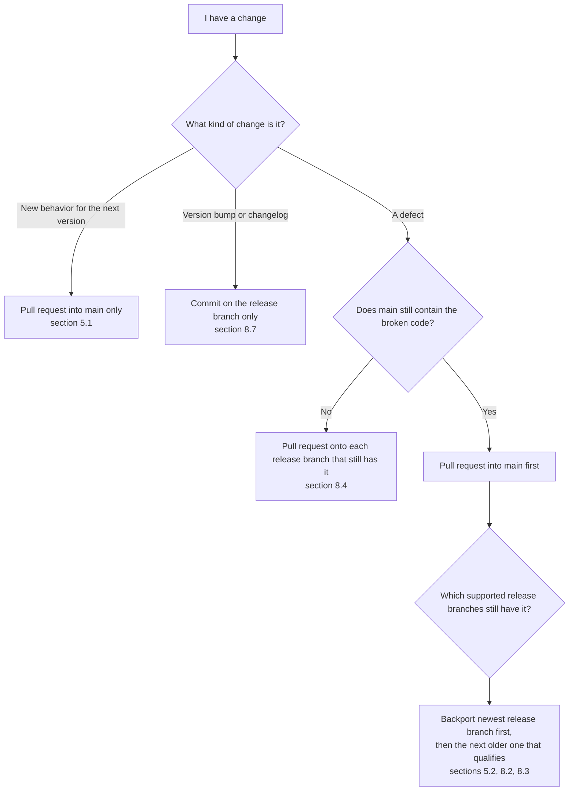

| You are looking at | Go to |
| --- | --- |
| A feature, or a fix nobody has shipped yet | [5.1](#51-build-day-a-feature-for-the-next-version) |
| Customers are on 1.4, 1.5 is only on `main`, and 1.4 has the bug | [5.2](#52-fix-day-customers-are-on-14-and-15-is-still-only-on-main) |
| 1.5 is feature-complete and must freeze while `main` continues | [8.1](#81-cut-the-next-release-while-main-moves-on) |
| QA finds a bug on the frozen 1.5 candidate | [8.2](#82-a-bug-shows-up-while-that-release-is-freezing) |
| 1.5.0 is already tagged, and a bug is found | [8.3](#83-a-bug-after-the-next-version-has-shipped) |
| The crashing function no longer exists on `main` | [8.4](#84-the-broken-code-is-gone-on-main) |
| `git cherry-pick` stopped with a conflict | [8.5](#85-the-cherry-pick-conflicts) |
| Someone already merged the fix only onto `release/1.4` | [8.6](#86-the-fix-was-committed-on-the-release-branch-first) |
| It is time to write `1.4.3` into the version file | [8.7](#87-version-bump-and-changelog) |
| It is time to publish | [8.8](#88-tag-the-build-and-publish-the-github-release) |
| 1.3 will never be patched again | [8.9](#89-the-line-is-out-of-support) |
| You must patch a line that is out of support | [8.10](#810-you-must-patch-a-line-that-is-out-of-support) |
| The ticket says NMM 1.4, and you are inside `bff` or `core1` | [8.11](#811-nmm-the-bundle-number-is-not-the-branch-name) |

Moments used below:

| Moment | `main` | `release/1.5` | `release/1.4` | `release/1.3` |
| --- | --- | --- | --- | --- |
| A. Building 1.5 | 1.5 work | does not exist | current line, `v1.4.0` shipped | security and critical only |
| B. Freezing 1.5 | 1.6 work has started | just cut, not tagged | still the customer line | security and critical only |
| C. 1.5 has shipped | 1.6 work | current line, `v1.5.0` shipped | previous line, security and critical only | out of support; branch kept, no normal patches |

---

## 8. Scenarios

### 8.1 Cut the next release while `main` moves on

**Who:** release owner. **Moment A, becoming moment B.**

1.5 is feature-complete on `main`. QA needs a frozen candidate. Developers are about to start 1.6.

**Example 1 — this repo will ship a new tag, with a release candidate.**

1. Cut the branch from the current `main`. Do this once.
   ```bash
    git fetch origin
    git switch main
    git pull origin main
    git switch -c release/1.5
    git push -u origin release/1.5
   ```
2. On `release/1.5` only, open a pull request that sets the version to `1.5.0-rc.1` and writes the 1.5 changelog. **base:** `release/1.5`. That commit is release-only. It is not copied to `main`.
3. Tell the team: 1.6 work goes to `main`. Anything that must be in 1.5 is a fix on `main` plus a backport onto `release/1.5`.
4. QA runs on the release candidate. Bugs follow [section 8.2](#82-a-bug-shows-up-while-that-release-is-freezing).
5. When QA signs off, bump `1.5.0-rc.1` → `1.5.0` on `release/1.5`, tag `v1.5.0`, and publish the GitHub Release ([8.8](#88-tag-the-build-and-publish-the-github-release)).

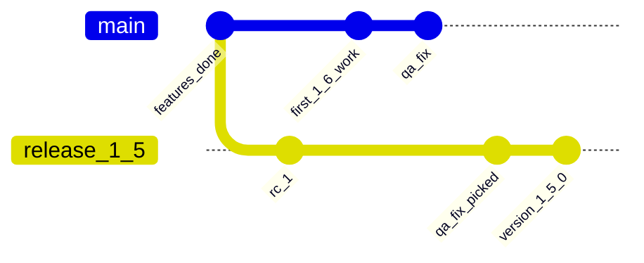

`release_1_5` is `release/1.5`. `qa_fix` landed on `main` first. `qa_fix_picked` is the cherry-pick. `version_1_5_0` stays on the release branch. The tag `v1.5.0` points at that version commit.

**Example 2 — this repo has nothing new in the bundle.**

`core2` has not changed since the tag the previous bundle already pins. Do not cut `release/X.Y`, do not bump a version, and do not invent an empty tag. The new manifest repeats the previous `core2` tag. Cutting a branch “so every repo matches” creates a line nobody needed to patch.

A short freeze with no release candidate is the same as example 1, minus the `rc.1` commit: cut `release/1.5`, backport any last fixes, bump straight to `1.5.0`, tag.

### 8.2 A bug shows up while that release is freezing

**Moment B.** `release/1.5` is in QA. `main` already has 1.6 work. Customers are still on 1.4. The bug is in the 1.5 candidate. You check `main`: the same crash is there.

The fix still goes to `main` first, then onto `release/1.5`. Going to `main` first means 1.6 cannot ship the bug later. The 1.4 line is a separate decision: patch it only if customers on 1.4 hit it and 1.4 is still the line that receives normal fixes. In moment B, 1.4 is still that line, so a crash customers can hit on 1.4 is also backported to `release/1.4`, after `release/1.5`.

**Example 1 —** `main` **has barely touched this function. The cherry-pick is clean.**

The crash is a missing null check in `calculateTotal`. 1.6 work has been in another package.

1. Open `fix/null-tax` from `main`, pull request **base:** `main`, label `backport-to-release/1.5` and, because 1.4 still gets normal fixes, `backport-to-release/1.4`.
2. After merge, take the squash SHA `a1b2c3d`.
3. Backport recipe onto `release/1.5`. Pull request title `[1.5] Fix crash when tax code is null`. Merge it.
4. Backport recipe again, from `a1b2c3d`, onto `release/1.4`. A second branch, `backport/null-tax-1.4`, and a second pull request. Merge it.
5. Release owner includes the fix in the upcoming `v1.5.0`, and tags `v1.4.1` for the customer line.

Both backports cherry-pick `a1b2c3d`. You do not cherry-pick the 1.5 backport commit onto 1.4.

If the crash comes from a 1.5 feature that `v1.4.0` does not contain, skip the `release/1.4` backport. That line never ran the broken code, so it does not get a patch.

**Example 2 — 1.6 already edited the same function, and the patch still applies.**

`main` has renamed a helper two files away and added a log line inside `calculateTotal`. The null check itself is still the same line 1.5 has.

Repeat steps 1–4. Expect the `release/1.5` cherry-pick to apply cleanly, because 1.5 was cut before the rename. Expect the `release/1.4` cherry-pick to apply cleanly for the same reason. If either stops with a conflict, go to [8.5](#85-the-cherry-pick-conflicts) and finish that backport before tagging anything on that line.

What you do not do: branch from `release/1.5`, fix only there, and plan to “merge the release branch into `main` at the end of QA.” At the end of QA, `main` contains 1.6. A merge would carry `1.5.0-rc.1`, the changelog, and any 1.5-only workaround into 1.6.

### 8.3 A bug after the next version has shipped

**Moment C.** `v1.5.0` is the current release. `main` is 1.6. `release/1.4` is the previous minor: security and critical only. `release/1.3` is still on the remote but out of support: no normal patches unless a release owner reopens it.

The bug: a download whose file name contains a slash is saved with the wrong name. It is embarrassing and it has a workaround. It is not a security issue and it is not critical.

**Example 1 — found on the current line, 1.5.**

1.5 customers hit it. 1.6 on `main` has the same code.

1. Pull request into `main`: `Fix download names that contain a slash`. Merged as `c0ffee1`.
2. Backport recipe onto `release/1.5`. Title `[1.5] Fix download names that contain a slash`.
3. Stop. Do not open a 1.4 backport. 1.4 is the previous minor, and this bug does not qualify.
4. Release owner tags `v1.5.1` on `release/1.5`.
5. A customer still on 1.4 is pointed at 1.5.1. Their ticket resolves as fixed in the newer line.

**Example 2 — the same bug is reported by a customer who never left 1.4.**

The reproduction is on `v1.4.2`. You confirm `main` and `release/1.5` have it too.

The route does not change because of who reported it. 1.4 is outside the normal-fix window.

1. Land the fix on `main` (`c0ffee1`).
2. Backport onto `release/1.5` so the upgrade target contains the fix. Tag `v1.5.1`.
3. Leave `release/1.4` untouched.
4. The customer-facing resolution is upgrade to the bundle that contains `v1.5.1`, not a 1.4.3 build.

Opening a 1.4 backport “while you are here” starts a patch you will then owe to every similar report, and it publishes a 1.4 build that is ahead of the policy the rest of the team is applying.

**Example 3 — the defect is critical, so the previous minor qualifies too.**

An auth token is accepted after it has expired. That is security. Current line and previous line both get it. 1.3 stays closed.

1. Pull request into `main`. Label `backport-to-release/1.5` and `backport-to-release/1.4`. Merged as `d00d1e1`.
2. Backport `d00d1e1` onto `release/1.5` first. Merge that pull request. The release owner can tag `v1.5.1` as soon as this is in.
3. Backport `d00d1e1` again onto `release/1.4`. Merge it. Tag `v1.4.3` only after step 2 is merged, so an upgrade from 1.4.3 to 1.5.1 still has the check.
4. `main` has the fix for 1.6. No third backport.

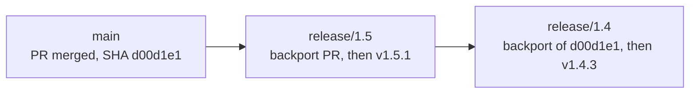

If the 1.5 cherry-pick conflicts and you re-implement it, the 1.4 cherry-pick still starts from `d00d1e1` on `main`. It does not start from the 1.5 re-implementation.

### 8.4 The broken code is gone on `main`

**Moment C, and the same rule in any moment.**

1.4 formats legacy upload paths with `formatLegacyPath()`. A null path crashes it. 1.5 deleted that function when uploads were rewritten. You search `main`: there is nothing to fix, and 1.6 cannot regress into this crash.

1. Say so on the ticket: `main` does not contain `formatLegacyPath`. There will be no pull request to `main`.
2. Check each release branch that is still supported and still contains the function.
   - `release/1.5`: function is gone. Stop for this line.
   - `release/1.4`: function is present. This is the previous minor, so you patch it only when the defect is security or critical. A crash in a legacy upload path that loses a file is critical: patch it.
3. Branch from the release branch and write the fix there. There is no SHA on `main` to cherry-pick.
   ```bash
    git fetch origin
    git switch -c fix/legacy-path-1.4 origin/release/1.4
   ```
4. Pull request, **base:** `release/1.4`. Title: `[1.4] Fix crash on an empty legacy upload path`. Body: `Does not apply to main. formatLegacyPath was removed in 1.5.`
5. If an older line such as 1.3 still has the function, leave it alone unless a release owner reopens 1.3. The branch existing is not enough. The support window has to qualify the line.

### 8.5 The cherry-pick conflicts

Conflicts mean the surrounding lines on the release branch no longer match the lines the `main` commit was written against. You keep the release branch’s code for everything except the fix.

**Example 1 — both sides edited the same line. Keep the real fix.**

You are backporting `a1b2c3d` onto `release/1.4`. 1.4 already contains a hasty workaround, `|| ""`, on the line you changed. Cherry-pick stops.

```text
function calculateTotal(invoice) {
<<<<<<< HEAD
  const tax = invoice.tax || "";
=======
  const tax = invoice.tax ?? "VAT0";
>>>>>>> a1b2c3d (Fix crash when tax code is null)
  return invoice.net * rates[tax];
}
```

`HEAD` is `release/1.4`. The other side is the fix. `|| ""` still crashes later, because an empty string is not a rate-table key. The intent of `a1b2c3d` is “a missing tax becomes VAT0.”

Resolved file:

```javascript
function calculateTotal(invoice) {
  const tax = invoice.tax ?? "VAT0";
  return invoice.net * rates[tax];
}
```

```bash
git add src/calculateTotal.js
git cherry-pick --continue
```

Push and open the pull request as in the recipe. The body still says `Backport of #431`.

**Example 2 — the** `main` **fix does not fit this tree. Re-implement the intent.**

`a1b2c3d` on `main` looks like this, because 1.5 renamed the field and replaced the rate table:

```javascript
function calculateTotal(invoice) {
  const tax = invoice.taxCode ?? "VAT0";
  return invoice.net * rate(tax);
}
```

`release/1.4` still has `invoice.tax` and a `rates` table, and it has no `rate()` helper. Cherry-pick reports that it cannot apply. Forcing the 1.5 names into 1.4 would not compile.

```bash
git cherry-pick --abort
```

Stay on `backport/null-tax-1.4`, which is still `origin/release/1.4` plus no commit. Write the 1.4-shaped fix:

```javascript
function calculateTotal(invoice) {
  const tax = invoice.tax ?? "VAT0";
  return invoice.net * rates[tax];
}
```

```bash
git add src/calculateTotal.js
git commit -m "$(cat <<'EOF'
Fix crash when tax code is null.

Backport of #431 (a1b2c3d).
1.4 still uses invoice.tax and the rates table, so this is the same intent as main, not the same diff.
EOF
)"
git push -u origin backport/null-tax-1.4
```

The pull request **base** is still `release/1.4`. Reviewers compare behavior, not a matching diff. A missing tax on 1.4 becomes `VAT0` and the total renders.

If you cannot tell what the release branch should keep, stop and ask. Guessing in a conflict marker is how 1.6 code lands on 1.4.

### 8.6 The fix was committed on the release branch first

**This is the escape hatch, not the default path.** Production is down on Friday. You branch from `release/1.4`, fix, and the pull request into `release/1.4` merges the same day so a patch can be tagged. `main` does not have it yet.

On Monday you forward-port that one commit, or 1.5 and 1.6 ship the outage again.

The release-branch SHA is `b4c5d6e`.

```bash
git fetch origin
git switch main
git pull origin main
git switch -c forwardport/null-tax
git cherry-pick -x b4c5d6e
git push -u origin forwardport/null-tax
```

Pull request **base:** `main`. Title: `Fix crash when tax code is null`. Body: `Forward-port of #432 (b4c5d6e), which landed on release/1.4 first.`

If 1.5 has already rewritten the function, abort and re-implement the intent on `main`, the same way [example 2 in 8.5](#85-the-cherry-pick-conflicts) re-implemented it on 1.4. The commit message names `#432`.

Then look at newer release branches that were cut before this forward-port and still have the bug. Cherry-pick the **new** `main` **SHA** onto those, newest first. `release/1.4` already has the fix. Leave it.

You still do not merge `release/1.4` into `main`. That merge would bring the 1.4 version bump and changelog with the fix.

### 8.7 Version bump and changelog

**Who:** release owner. The fix pull requests are already merged.

`release/1.4` now contains the null-tax fix and the previous tag `v1.4.2`. The version file on that branch still says `1.4.2`. The tag you are about to create has to match the version file.

1. Branch from the release branch.
   ```bash
    git fetch origin
    git switch -c release-prep/1.4.3 origin/release/1.4
   ```
2. Set the version to `1.4.3` in the version file this repo uses (`package.json`, the `.csproj`, or whatever it already uses). Add a changelog entry that names the crash fix and links #432.
3. Pull request, **base:** `release/1.4`. Title: `Release 1.4.3`. No label for a backport. This commit must not be cherry-picked to `main`. `main` is 1.6 and will get its own version when its own release branch is cut.
4. Merge.

What belongs on which branch:

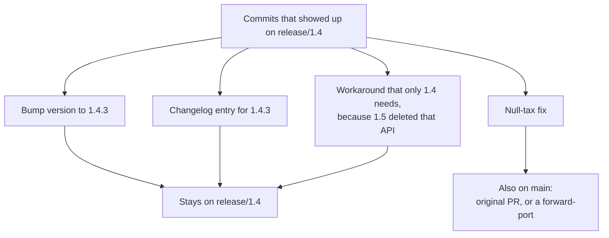

A developer’s fix pull request does not include this bump. Mixing them means the backport either carries a version number onto `main`, or the `main` fix carries `1.4.3` in its diff and then conflicts on every line.

After the cut in [8.1](#81-cut-the-next-release-while-main-moves-on), `main` may still show `1.4.0` in the version file. That is expected. The number customers install is the tag. You do not merge `release/1.4` into `main` to “update the version.” If we want `main` to read `1.6.0-dev`, that is a new commit written on `main`.

### 8.8 Tag the build and publish the GitHub Release

**Who:** release owner. The version-bump pull request from 8.7 is merged.

1. Confirm the branch tip is the commit you mean to ship.
   ```bash
    git fetch origin
    git switch release/1.4
    git pull origin release/1.4
    git log --oneline -5
   ```

    You want to see the version bump on top, and the fix underneath:
2. Tag that tip. An annotated tag stores the message on the tag.
   ```bash
    git tag -a v1.4.3 -m "Release 1.4.3"
    git push origin v1.4.3
   ```
3. On GitHub: **Releases → Draft a new release**.
   - **Choose a tag:** `v1.4.3`. Choose the existing tag. Do not type a new tag name against `main`.
   - Title: `1.4.3`.
   - Describe the fixes, or generate notes and then delete anything that is not on this line.
   - Publish.

**Example 1 —** `v1.4.3` **is the newest version we have published.** 1.5 is not out. In the release form, set this release as the latest.

**Example 2 —** `v1.5.0` **is already published, and you are now shipping** `v1.4.3` **for the previous line.** GitHub’s “latest” badge is what people and tooling notice. A 1.4 patch must not replace 1.5 as Latest. In **Set as the latest release**, keep `v1.5.0` as the latest. Mark a release candidate (`v1.5.0-rc.1`) as a **pre-release**, so it never becomes Latest.

The tag does not move if you find another bug tomorrow. You merge another fix, bump to `1.4.4`, and create `v1.4.4`. You do not delete `v1.4.3` and point it at a new commit.

A tag is a name for one commit. It is not stored “on” the branch. `v1.4.0` remains the old commit after `release/1.4` has moved on to `v1.4.3`, and after `main` has moved on to 1.6.

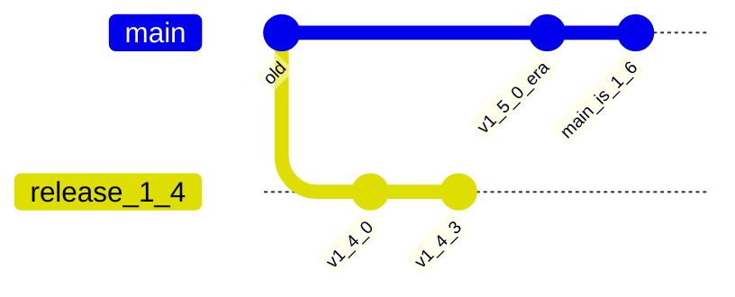

Tagging the right-hand tip of `main` as `v1.4.3` would publish 1.6 work under a 1.4 number. The tag belongs on `v1_4_3` in that diagram, which is the `release/1.4` commit.

### 8.9 The line is out of support

**Moment C, a bit later.** `v1.6.0` has shipped. The window is current minor plus the previous minor for security and critical fixes. 1.5 is the previous minor. 1.4 will not be patched again.

Do **not** delete `release/1.4`. The branch stays on the remote so history, tags, and an exceptional reopen stay simple. Out of support means:

1. Stop opening normal or security backports onto `release/1.4` unless a release owner explicitly reopens the line ([8.10](#810-you-must-patch-a-line-that-is-out-of-support)).
2. Close or retarget any open pull request that still aims at `release/1.4` for routine work.
3. Confirm the ships are still reachable from the tags:
   ```bash
    git fetch origin --tags
    git switch --detach v1.4.3
   ```

    You are on the commit we shipped. `git switch main` when you are finished.

A ticket against 1.4 now resolves as an upgrade to the oldest supported line that contains the fix. The branch remaining is not an invitation to patch it.

### 8.10 You must patch a line that is out of support

A release owner has agreed to an exception: 1.2 has a critical security issue, and one more tag is required. `release/1.2` is still on the remote (branches are kept). The last tag is `v1.2.3`.

1. If `main` still has the vulnerable code, land the fix on `main` first and backport it to every **supported** line as well, newest first. The exception does not skip the current train.
2. Cherry-pick the `main` SHA onto a backport branch from `origin/release/1.2`, or re-implement the intent if 1.2’s code has diverged ([8.5](#85-the-cherry-pick-conflicts)).
3. Version bump to `1.2.4` on `release/1.2`, tag `v1.2.4`, push the tag, publish the GitHub Release. Do not mark it as Latest ([example 2 in 8.8](#88-tag-the-build-and-publish-the-github-release)).
4. Leave `release/1.2` in place. If the exception was a defined reopen period, resume “no normal patches” when that period ends. Do not delete the branch.

### 8.11 NMM: the bundle number is not the branch name

NMM customers install a **bundle**. The bundle is a manifest of five tags. Each tag lives in its own repository, on that repository’s own `release/X.Y` branch. `NMM 1.4` does not mean “create `release/1.4` in `bff`.”

Open the manifest for the bundle you are patching. The branch is `release/` plus the major.minor of **that repo’s tag**.

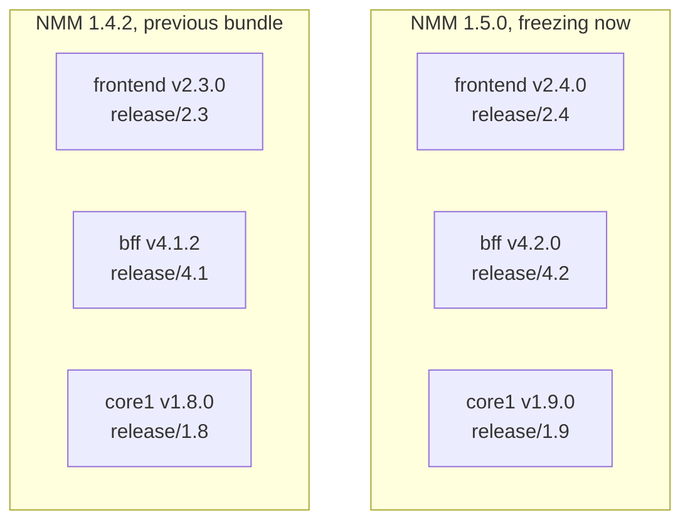

`core2` and `core3` work the same way. They are omitted from the picture so the three that this section edits stay readable. A repo whose tag is repeated unchanged does not get a new branch.

The support window from [section 3](#which-lines-still-receive-the-fix) applies to **NMM 1.5** and **NMM 1.4**, not to “bff 4.x versus bff 4.y” on its own. You translate the bundle into branches only after you know which bundles qualify.

**Example 1 — one repository, two bundles. Critical bug in** `bff`**.**

The tags in both examples are illustrative, so every branch name is visible. On a real ticket, read the published manifest and use the tags it lists.

Customers on NMM 1.4.2 can be signed in with an expired token. The check lives in `bff`. NMM 1.4.2 is what customers run. NMM 1.5.0 is frozen and not tagged yet, and it has the same check. An expired token is security, so both bundles get the fix. Older bundles do not.

Manifest pins:

| Bundle | bff tag | Branch in the bff repo |
| --- | --- | --- |
| NMM 1.5.0 (not tagged yet) | `v4.2.0` will be cut from this branch | `release/4.2` |
| NMM 1.4.2 | `v4.1.2` already tagged | `release/4.1` |

In the **bff** repository:

1. Pull request into `bff` `main`. That is the unreleased bff work after 4.2. Label `backport-to-release/4.2` and `backport-to-release/4.1`. Merged as `e1e1e1e`.
2. Backport recipe onto `release/4.2` first. Title `[4.2] Reject expired auth tokens`. This commit becomes part of `v4.2.0`, because 4.2.0 is not tagged yet.
3. Backport `e1e1e1e` onto `release/4.1`. Title `[4.1] Reject expired auth tokens`. The release owner bumps to `4.1.3` and tags `v4.1.3`.
4. `frontend`, `core1`, `core2`, and `core3`: no pull request. Their tags are repeated in both manifests.

The release owner then publishes a new manifest, not a new branch name:

```yaml
bundle: 1.4.3
components:
  frontend: v2.3.0   # unchanged
  bff: v4.1.3        # the patch
  core1: v1.8.0      # unchanged
  core2: v3.0.1      # unchanged
  core3: v0.9.4      # unchanged
```

NMM 1.5.0’s manifest will pin `bff: v4.2.0`, which now contains the same fix. One code fix, one entry per bundle you still support.

**Example 2 — two repositories, one bundle. A normal QA bug on the 1.5 train.**

QA of NMM 1.5 finds that a slash in a file name is mishandled. The bug is in `bff` and in `core1`. It is a normal bug on the current train. NMM 1.4 does not get a patch. Both repositories still follow this guide inside their own history.

In **core1**:

1. Pull request into `core1` `main`.
2. Backport onto `release/1.9` only. That is the branch NMM 1.5 pins (`v1.9.0` is not tagged yet, so the fix rides along in `v1.9.0`).
3. No pull request to `release/1.8`.

In **bff**, in parallel:

1. Pull request into `bff` `main`.
2. Backport onto `release/4.2` only.
3. No pull request to `release/4.1`.

`frontend`, `core2`, and `core3` stay on the tags they already had. The NMM 1.5.0 manifest bumps `bff` and `core1` and repeats the other three.

```yaml
bundle: 1.5.0
components:
  frontend: v2.4.0
  bff: v4.2.0
  core1: v1.9.0
  core2: v3.1.0
  core3: v0.10.0
```

The Jira task for a repo is done when the change is on `main` and on the release branch that bundle will tag. The customer ticket moves when the **bundle** is released, not when your pull request merges. Status names and the board are in [DEVELOPMENT_LIFECYCLE.md](./DEVELOPMENT_LIFECYCLE.md).

---

## 9. Reviewing a pull request

**A pull request into** `main`

- The base is `main`.
- The diff is the feature or the fix that was asked for.
- The version file and changelog are unchanged, unless the release owner is deliberately setting the next dev version on `main`.
- A fix that customers on a supported line can still hit has a `backport-to-release/X.Y` label for each of those lines.
- If there is a `backport-to-release/X.Y` label, confirm a linked backport pull request exists (or is listed in the body) before approving. The label alone is not enough.

**A backport**

- The base is `release/X.Y`, and the title starts with `[X.Y]`. That line still qualifies for this fix (supported window, or an explicit reopen).
- There is one commit, or a re-implementation whose message names the original pull request and SHA.
- **Files changed** matches the original fix. A diff of the whole repository is a branch cut from `main`. Close it.
- The version file is untouched. A version bump is the release owner’s separate pull request.
- CI is required. A cherry-pick is still a change to that line.

**A forward-port**

- The base is `main`.
- The body names the release-branch pull request.
- It does not contain that line’s version bump or changelog.

---

## 10. Cheat sheet

| Situation | First pull request | Then | Tag |
| --- | --- | --- | --- |
| Feature for the next version | `main` | Stop | Later, when that version is cut |
| Fix only the next version has | `main` | Stop | Later |
| Fix the line customers are on, next version not cut yet | `main` | Backport to that `release/X.Y` | `vX.Y.(Z+1)` on the release branch |
| Cut the next version | Create `release/X.Y` from `main` | Version bump stays on it. Further fixes: `main`, then cherry-pick | `vX.Y.0` on the release branch |
| QA bug on a frozen release | `main` | Backport to that release branch, newest first if an older line also qualifies | Included in the tag for each line you patched |
| Normal bug after a newer minor has shipped | `main` | Backport only to the current minor’s release branch | Patch tag on that current line. Older customers upgrade |
| Security or critical bug | `main` | Current release branch, then the previous minor’s release branch | A patch tag on each of those lines |
| Broken code already deleted on `main` | The release branch that still has it | Any other qualifying line that still has it | Patch tag on those lines only |
| Fix already merged on a release branch | Forward-port to `main` | Backport the new `main` SHA to any newer release branch that missed it | Whoever still needs a ship |
| End of support | — | Leave `release/X.Y` in place; stop normal backports | Keep every `vX.Y.Z` |
| Exceptional patch of an out-of-support line | Fix `main` if the bug exists there | Backport onto the existing `release/X.Y` (release owner reopen) | `vX.Y.(Z+1)`, not marked Latest |

Commands you will actually run:

```bash
# which release lines exist (then apply the support window — existence ≠ patch)
git fetch origin
git branch -r | grep 'origin/release/'

# feature or fix on the next version
git fetch origin
git switch -c fix/null-tax origin/main

# backport onto a release line, after the main pull request has merged
git fetch origin
git switch -c backport/null-tax-1.4 origin/release/1.4
git cherry-pick -x <sha-on-main>

# forward-port onto main
git fetch origin
git switch -c forwardport/null-tax origin/main
git cherry-pick -x <sha-on-release-branch>

# one commit means the branch was cut from the right place
git log --oneline origin/release/1.4..HEAD
```

---

## 11. Where to read more

- [DEVELOPMENT_LIFECYCLE.md](./DEVELOPMENT_LIFECYCLE.md) — quarterly train, manifests, and what the customer sees.
- [JIRA_BUNDLE_DELIVERY.md](./JIRA_BUNDLE_DELIVERY.md) — the checklist the release owner runs to publish a bundle.
