# Developer guide: trunk + release branches

## Overview

This guide is for developers on any component repository that ships **numbered builds consumers pin** (for example a package, a library, or a service that customers keep on an older build after a newer one exists). Every such repository uses the same method. Version numbers differ per component; the GitHub workflow does not.

Most of our repositories start with `main` and `develop` only. This guide replaces that setup with a trunk + release branch strategy. Here is the key difference in structure and daily workflow:

| Before (typical today) | After (this guide) |
| --- | --- |
| `main` + long-lived `develop` | One trunk only: `main` (no `develop` branch) |
| Features and fixes land on `develop`, then usually reach `main` during a release | Features and product fixes land directly on `main` via pull requests |
| Releases are made directly on `main` | When a version freezes, cut `release/X.Y` from `main`. Stabilize that line there and tag every ship (`v1.4.0`, `v1.4.1`, …) |
| No clear strategy for fixing bugs on older shipped versions | Land the fix on `main`, cherry-pick it onto `release/X.Y` (where `v1.4.0` shipped), and create a new patch tag on that branch (`v1.4.1`) |

A `release/X.Y` branch is created **the first time that version is ready to freeze**, not on day one of the repository. Until then, you only work on `main`. The rest of this guide shows when to cut that branch, how to backport a fix onto it, and how to tag.

If a repository only ever deploys the tip of `main` and never has to patch an older *build*, you do not need release branches or backports. Fix on `main` and stop. That case is outside this guide.

> **Note on version numbers:** The versions in the examples (`1.4`, `1.5`, `1.6`) are stand-ins — substitute the real `X.Y` of your repository. A repository can keep several older minors at once (`release/1.3`, `release/1.2`, …). Release branches stay open; leaving support means you stop opening normal backports onto that line, not that you delete the branch ([section 3](#which-lines-still-receive-the-fix)).

## Table of contents

1. [What this is](#1-what-this-is) — Why we use trunk + release branches and the core principles
2. [How each component is versioned](#2-how-each-component-is-versioned) — Semantic Versioning (`X.Y.Z`), pre-releases for QA, branch naming, tags, and merge policy
3. [Rules](#3-rules) — The 7 core rules and the support window for older releases
4. [Who does what](#4-who-does-what) — PO, Architect, DevLead, QA, and developer responsibilities
5. [A normal day](#5-a-normal-day) — Step-by-step for a normal feature day and a normal bug-fix day
6. [The backport recipe](#6-the-backport-recipe) — How to cherry-pick a fix from `main` onto a `release/X.Y` branch
7. [Find your situation](#7-find-your-situation) — Decision flowchart and lookup table for any scenario
8. [Scenarios](#8-scenarios) — Detailed walkthroughs (cutting a release, QA freeze bugs, conflicts, forward-ports, tagging, legacy tags, multi-component bundles)
9. [Reviewing a pull request](#9-reviewing-a-pull-request) — Reviewer checklist for `main`, backport, and forward-port PRs
10. [Cheat sheet](#10-cheat-sheet) — Summary table and copy-paste Git commands

---

## 1. What this is

When a repository uses `main` + `develop` and tags releases directly on `main`, two problems appear as soon as consumers pin versions:

1. You cannot freeze `1.4` for QA while merging `1.5` features without `develop` and `main` blocking each other.
2. Once `main` has moved on to `1.5` commits, you have no branch where you can safely build `v1.4.1` without dragging `1.5` work into the patch.

By introducing `release/X.Y` branches, these issues are resolved:

- **Every feature and bug fix starts on `main`.** Open a pull request into `main`. There is no `develop` branch to keep in sync, and the same steps apply in every repository.
- **You can stabilize one version while building the next.** When `1.4` is ready to freeze, cutting `release/1.4` lets QA stabilize `1.4` while `1.5` work continues on `main`. The two lines do not wait on each other.
- **A bug-fix release stays on its own line.** Consumers on `1.4` receive only the same bug fix applied onto `release/1.4` (`v1.4.1`). They never receive unfinished `1.5` work that already sits on `main`.
- **Later releases already contain the fix.** Because fixes land on `main` first, a consumer who upgrades from `1.4.1` to `1.5.0` never walks back into an old bug.
- **A released build never changes.** Once you publish `v1.4.0` or `v1.4.1`, that tag always points to the exact commit that was shipped. A later bug fix becomes a new tag (`v1.4.2`), not a moved or rewritten `v1.4.1`.

### Principles

1. **One trunk (`main`).** `main` always holds the newest unreleased work. All feature work and product fixes land here first.
2. **One `release/X.Y` branch for each new `X.Y` release.** Example: when `1.4` is feature-complete and ready for QA, create `release/1.4` from `main`. From that moment, `1.4` only receives bug fixes and version tags on that branch, while new feature work continues on `main` toward `1.5`. All builds on that line (`1.4.0`, `1.4.1`, `1.4.2`) stay on the same `release/1.4` branch — you do not create a new branch per patch. Until the first release is ready, only `main` exists. After support ends, keep the branch; stop opening normal backports onto it.
3. **Land the fix on `main` first, apply that same fix onto each `release/X.Y` that still needs it, then tag the ship (`vX.Y.Z`).**

   What consumers install is a **tag** on the release branch (for example `v1.4.0` for the first ship, then `v1.4.1` for a later bug-fix build), not the moving tip of `main`. `main` keeps receiving the next version’s work; a tag names one exact commit that was approved and shipped.

   In practice that means three steps:

   1. Write and merge the product fix on `main`, so every future release already contains it.
   2. Bring that same fix onto each supported `release/X.Y` that still has the defect. You can **copy the change manually** onto the release branch (same behavior, adapted to that line’s code), or use `git cherry-pick` as the easier method when the change applies cleanly. If cherry-pick stops with conflicts because the release branch has diverged (renamed APIs, different structure), abort and finish the fix by hand. Either way you open a pull request into `release/X.Y` and get a new commit with a new SHA.
   3. On `release/X.Y`, bump the version **from** the last shipped build **to** the next patch (for example `1.4.0` → `1.4.1`), create the annotated tag that matches (`v1.4.1`) on that branch, and publish the GitHub Release from it.

   Do **not** merge the whole `release/X.Y` branch into `main`, and do **not** merge one release branch into another. A full merge would drag version bumps, changelogs, and release-only commits into the wrong line. Product fixes already live on `main` (step 1). If an urgent fix was committed on `release/X.Y` first, copy **that one fix** onto `main` — never merge the entire release branch. Version bumps and changelogs stay on the release branch they belong to.


The same rules, as history. The diagram below walks through every common case on one timeline.

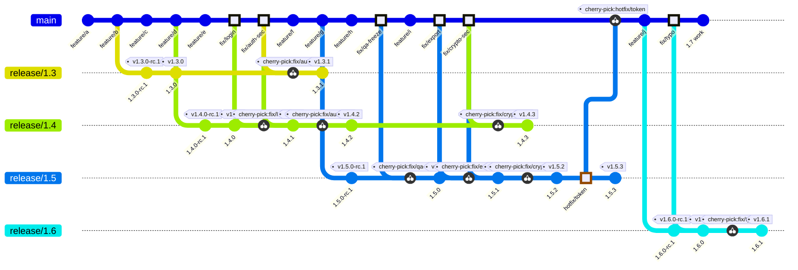

Highlighted commits are fixes. Each `cherry-pick` on a release branch is the same fix applied there (Mermaid draws the link). `parallelCommits` lines those related commits up in the same column when you view it on [mermaid.live](https://mermaid.live).

In that diagram, left to right:

1. **Build and cut (with RC).** Features land on `main`. Every new minor freezes the same way: cut `release/X.Y`, tag `vX.Y.0-rc.1` for QA, then tag final `vX.Y.0`. Shown for `1.3` and `1.4` (and later `1.5` / `1.6`). Features never start on a release branch. RC bumps stay release-only — do not copy them to `main`.
2. **Normal bug on the current line.** `fix/login` lands on `main` first, then only onto `release/1.4` (`v1.4.1`). `release/1.3` is the previous minor, so it does **not** get a normal bug fix.
3. **Security / critical on current + previous.** `fix/auth-sec` lands on `main`, then onto `release/1.4` (`v1.4.2`) and `release/1.3` (`v1.3.1`). Newest qualifying line first.
4. **QA bug while an RC is freezing.** Cut `release/1.5` → `v1.5.0-rc.1`. `fix/qa-freeze` lands on `main` first, then onto `release/1.5`, then final `v1.5.0`. Do not “merge the whole release branch back into `main`.” (`1.6` features already continue on `main` during this freeze.)
5. **Normal bug after `1.5` shipped.** `fix/export` goes to `main` and only `release/1.5` (`v1.5.1`). `release/1.4` is now previous minor — no normal patches there.
6. **Security after `1.5` shipped.** `fix/crypto-sec` goes to `main`, then `release/1.5` (`v1.5.2`), then `release/1.4` (`v1.4.3`). `release/1.3` is out of support — no commit (branch kept, not deleted).
7. **Forward-port (urgent fix on the release line first).** Rare path: `hotfix/token` is applied on `release/1.5` and tagged `v1.5.3`, then the **same fix only** is copied onto `main`. Never merge the whole `release/1.5` branch into `main`.
8. **Next minor, and out-of-support stays quiet.** Cut `release/1.6` → `v1.6.0-rc.1` → `v1.6.0`. A later normal `fix/typo` ships only on `release/1.6` (`v1.6.1`). `release/1.4` and `release/1.3` stay on the remote with no further normal backports. `main` keeps moving toward `1.7`.

---

## 2. How each component is versioned

### 2.1 Semantic Versioning (`MAJOR.MINOR.PATCH`)

Every component uses [Semantic Versioning](https://semver.org/) (`X.Y.Z`) and tags every release with a leading `v` (`vX.Y.Z`).

| Part | Example | When it increments | What happens in Git |
| --- | --- | --- | --- |
| **MAJOR** (`X`) | `1.4.2` → `2.0.0` | Breaking change to the component’s public API, contract, CLI, or configuration | Develop on `main`. When ready to freeze, cut `release/2.0` from `main` and tag `v2.0.0`. |
| **MINOR** (`Y`) | `1.4.2` → `1.5.0` | Backward-compatible new feature or enhancement | Develop on `main`. When ready to freeze, cut `release/1.5` from `main` and tag `v1.5.0`. |
| **PATCH** (`Z`) | `1.4.0` → `1.4.1` | Backward-compatible bug fix or security fix | **No new release branch.** Cherry-pick the fix onto existing `release/1.4`, bump the version to `1.4.1`, and tag `v1.4.1`. |
| **Pre-release** (`-rc.N`) | `1.5.0-rc.1` | Release candidate frozen for QA before the final ship | Bump to `1.5.0-rc.1` on `release/1.5`, tag `v1.5.0-rc.1`, and mark **Pre-release** on GitHub. |

If you are unsure whether a change is MAJOR, MINOR, or PATCH (especially anything that might break a public API, contract, CLI, or config), ask the **Architect** before the DevLead bumps the version.

**One release branch per `MAJOR.MINOR`, never per patch.** Branch names are always `release/X.Y` (such as `release/1.4`). Never create `release/1.4.0` or `release/1.4.1`. Every patch for the `1.4` line (`v1.4.0`, `v1.4.1`, `v1.4.2`, …) is tagged along that single `release/1.4` branch.

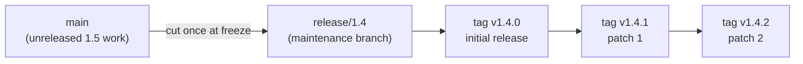

### 2.2 Independent version numbers per component

Each component repository owns its **own** version number:

1. **Version by what changed in this repository.** A component increments its major, minor, or patch number based on its own code and contract changes — not to match another repository’s version number.
2. **Unchanged components are not re-branched or re-tagged.** If a component has no new commits since `v3.0.1`, do not cut a new `release/X.Y` branch or tag `v3.1.0` just because sibling components are releasing. Keep `v3.0.1`.
3. **Multi-component products use a manifest.** When several components ship together as a numbered product or bundle, a release manifest records which component tag belongs to that product version ([section 8.11](#811-multi-component-releases-the-product-version-is-not-the-branch-name)).
4. **Who edits the version file.** Developers do not touch the version file (`package.json`, `.csproj`, `pyproject.toml`, `Cargo.toml`, etc.) or `CHANGELOG.md` in feature or bugfix pull requests. The DevLead updates them on `release/X.Y` right before tagging ([section 8.7](#87-version-bump-and-changelog)).

### 2.3 The words on the pull request

| Word | What it means here |
| --- | --- |
| `main` | The single trunk for the next version. Feature work lands here. Product fixes land here first. |
| `release/1.4` | The maintenance branch for every `1.4.x` tag. Created when `1.4` freezes. Stays open after `1.4` leaves support; only the patch window closes. |
| Tag `v1.4.2` | The exact commit shipped as `1.4.2` on `release/1.4`. Immutable. A GitHub Release is created from it. |
| Pre-release / RC (`v1.5.0-rc.1`) | Optional QA candidate on `release/1.5` before the final `v1.5.0`. Same branch; mark **Pre-release** on GitHub. See [section 2.4](#24-pre-releases-release-candidates--for-qa). |
| Feature / fix branch | A short-lived branch cut from `main`, named `feature/<thing>` or `fix/<thing>`. |
| Backport | A cherry-pick of a `main` commit onto a `release/X.Y` branch, opened as its own pull request. Branch name: `backport/<thing>-1.4`. |
| Forward-port | The reverse copy (`release/X.Y` → `main`), used only when an urgent fix was merged on a release branch before it reached `main`. |
| Release-only commit | A version bump, changelog update, or release note that belongs only to that `X.Y` line. It stays on `release/X.Y`. |
| Product fix | A change in behavior a consumer can observe. It belongs on `main` and on every supported `release/X.Y` branch that still has the defect. |

`main` and every `release/X.Y` branch are protected. Direct pushes to them are rejected. Every change goes through a pull request, including a one-line backport and a version bump.

**Merge policy:** Squash-merge into `main` and into every `release/X.Y` branch so each pull request becomes **one commit** with one SHA. Cherry-pick that single squash commit. Do not use merge commits or rebase-merges on those branches unless the repository has documented a multi-SHA cherry-pick path. If you must cherry-pick several commits, apply them oldest to newest — never cherry-pick a GitHub merge commit.

**Retiring `develop`:** There is no `develop` branch and no `hotfix/<thing>` branch type. If a repository still has a legacy `develop` branch from the old workflow, do not branch from it or open pull requests against it. Merge or close any remaining work into `main`, set `main` as the default branch, and remove `develop`.

### 2.4 Pre-releases (release candidates) — for QA

A **pre-release** (`1.5.0-rc.1`, tag `v1.5.0-rc.1`) is an optional **QA snapshot on the same `release/1.5` branch**. It is not a separate branch type, and it does not change the branching rules.

#### Where it sits in the flow

```text
main (1.5 work done)
        │
        │  create release/1.5
        ▼
release/1.5
   ├─ bump to 1.5.0-rc.1  →  tag v1.5.0-rc.1  (GitHub: Pre-release)
   ├─ QA finds bugs → fix on main → apply onto release/1.5
   ├─ optional: 1.5.0-rc.2, …
   └─ QA signs off → bump 1.5.0-rc.1 → 1.5.0 → tag v1.5.0  (GitHub: Latest)
```

#### How it fits the principles

| Principle | Pre-release behavior |
| --- | --- |
| One trunk | Feature work for `1.5` still finishes on `main` before you create `release/1.5`. |
| One `release/X.Y` per new release | `rc.1`, `rc.2`, and final `1.5.0` all live on **the same** `release/1.5`. |
| Fix on `main`, apply onto release, tag | Bugs found during RC QA still land on `main` first, then are applied onto `release/1.5` (manually or with `git cherry-pick`). The RC version bump stays release-only — do not copy it to `main`. |

#### What a pre-release is / is not

- **Is:** A named build for QA and stakeholders before the real ship; SemVer pre-release suffix (`-rc.N`); GitHub Release marked **Pre-release** so it is not `Latest`.
- **Is not:** A substitute for `release/1.5`. You still create that branch when `1.5` is feature-complete.
- **Is not:** Required. If the team skips RCs, create `release/1.5`, stabilize, bump straight to `1.5.0`, and tag `v1.5.0`.

#### Patch vs pre-release (easy to mix up)

| Build | Meaning |
| --- | --- |
| `v1.4.1` | Patch on an **already shipped** line (`1.4.0` → `1.4.1`) |
| `v1.5.0-rc.1` | Candidate for the **first** `1.5.0` ship, still on the QA path |

So a pre-release is the optional middle step **between creating `release/X.Y` and tagging the final `vX.Y.0`**. Same branch, same fix rules; only the version string and the GitHub **Pre-release** flag differ.

Step-by-step when cutting a release with an RC: [section 8.1](#81-cut-the-next-release-while-main-moves-on). Bugs found while QA is on an RC: [section 8.2](#82-a-bug-shows-up-while-that-release-is-freezing).

---

## 3. Rules

1. Start feature work from `main`, and open the pull request against `main`.
2. When `main` still has a defect, land the fix on `main` first.
3. Cherry-pick that `main` commit onto each supported `release/X.Y` branch that still has the defect. Newest release branch first. Each backport is its own pull request.
4. Leave version bumps and changelogs on the `release/X.Y` branch that is about to be tagged (never tag releases directly on `main`).
5. Put the tag (`vX.Y.Z`) on the `release/X.Y` commit you are shipping. Never move or delete a shipped tag.
6. Keep `release/X.Y` after that line leaves support. Stop opening normal backports onto it; do not delete the branch.
7. Treat a pull request whose **Files changed** tab shows the whole repository as the wrong branch. A backport changes the same few lines as the original fix.

### Which lines still receive the fix

Before you open backports:

1. Fetch and list the release branches that exist in the repository (or check GitHub → **Branches** → `release/`):
   ```bash
   git fetch origin --tags
   git branch -r | grep 'origin/release/'
   ```
2. If no `release/X.Y` branch exists yet (because the repository has not frozen its first release under this guide), stop after merging your fix to `main`.
3. If `release/X.Y` branches exist, apply the table below only to lines that still **qualify** for this defect. Because release branches stay open forever, `release/1.2` existing on the remote does not mean `1.2` gets every fix.
4. If an older version was tagged directly on `main` before the repository adopted `release/X.Y` branches and qualifies for a patch, the DevLead first cuts `release/X.Y` from that old tag ([section 8.10](#810-you-must-patch-an-out-of-support-or-legacy-tagged-version)).
5. If severity (normal vs. security/critical) or “does this older line still qualify?” is unclear, ask the **DevLead** before opening a backport. Do not open an older-line patch “while you are here.”

| Line | Normal bug | Security vulnerability, or a critical defect (outage, data loss, broken core workflow with no workaround) |
| --- | --- | --- |
| **Current minor** (what consumers are expected to run) and any **freezing minor** (cut, not yet tagged) | Yes | Yes |
| **Previous minor** (one minor before current) | No. Ship the fix on the current line; the consumer upgrades. | Yes |
| **Anything older** (`1.3`, `1.2`, …) | No | No, unless the PO approves and the DevLead reopens that line |

When components ship together in a product bundle, apply the table above to the **product bundle minor** first, then read that bundle’s manifest to see which component `release/X.Y` branch is pinned ([section 8.11](#811-multi-component-releases-the-product-version-is-not-the-branch-name)).

Always backport **newest release branch first**. A consumer who upgrades must never walk back into a bug that was already fixed on their older version:

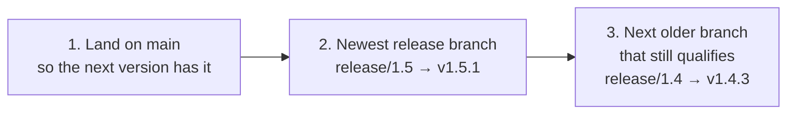

If you publish `v1.4.3` with the fix and forget `release/1.5`, a consumer who upgrades from `1.4.3` to `1.5.0` gets the bug back. Landing on `release/1.5` before tagging `v1.4.3` closes that regression hole.

---

## 4. Who does what

This team works in **Scrum**. There is no separate “release owner” role. Release work is split across the existing roles:

| Role | Owns in this guide |
| --- | --- |
| **Developer** | Feature and bug-fix pull requests into `main`, and the backport pull requests into each qualifying `release/X.Y`. Does **not** bump versions or create tags inside a fix. |
| **Architect** | Owns the public contract up front (API, CLI, config, cross-component compatibility). Confirms MAJOR vs MINOR vs PATCH when SemVer impact is unclear. Does **not** re-review every implementation pull request once that contract is agreed, and does **not** cut branches, bump versions, or tag. |
| **DevLead** | Git release mechanics: cut `release/X.Y`, version bump + changelog on that branch, annotated tag, GitHub Release. Also decides which lines still qualify when severity or the support window is unclear, and executes exceptional reopens of older lines. |
| **PO (Product Owner)** | Decides when a version is feature-complete and ready to cut, what belongs in the release, when a line leaves support, and whether an out-of-support line may be reopened for an exceptional patch. |
| **QA** | Tests candidates on `release/X.Y` (including `-rc.N` builds), signs off before the final `vX.Y.0` (or patch) tag, and files defects found during freeze. |

| Action | Who |
| --- | --- |
| Open a feature pull request into `main` | Developer who owns the work |
| Open a fix pull request into `main`, then open backport pull requests into each `release/X.Y` that qualifies under [section 3](#which-lines-still-receive-the-fix) | Developer who owns the fix (uses the support table; does not wait for the PO on every fix) |
| Review / approve ordinary pull requests | DevLead (or another developer per team practice) |
| Agree the public contract before implementation (API, CLI, config, cross-component) | Architect |
| Decide MAJOR vs MINOR vs PATCH when SemVer impact is unclear, or when a pull request would change an agreed contract | Architect (DevLead then applies that bump on `release/X.Y`) |
| Decide which lines still qualify when severity or support window is unclear | DevLead (escalate to PO only if it is a product / support-policy call, or an out-of-support reopen) |
| Decide the version is feature-complete and ready to cut | PO |
| Cut `release/X.Y` from `main` | DevLead |
| Test the candidate / RC on `release/X.Y` and sign off | QA |
| Version bump and changelog pull request on `release/X.Y` | DevLead |
| Annotated tag (`vX.Y.Z`) on `release/X.Y` and GitHub Release | DevLead |
| Mark a line out of support (stop normal patches; leave the branch) | PO decides; DevLead communicates and enforces |
| Exceptional reopen of an out-of-support or legacy-tagged line | PO approves; DevLead creates/uses `release/X.Y` and tags |

If you own the fix, you own the backport pull requests. You do not tag, and you do not bump the version inside the fix — that is the DevLead’s separate pull request on `release/X.Y`.

---

## 5. A normal day

Two workflows cover most weeks. The first never touches a release branch. The second touches one.

### 5.1 Build day — a feature (or unreleased fix) on `main`

**At this moment.** You are building the next version on `main` (either before the repository’s very first `release/X.Y` branch is cut, or while consumers run `v1.4.0` from `release/1.4` and `1.5` is being built on `main`). You are adding CSV export of invoices.

You will only touch `main`. Even if `release/1.4` exists, CSV export is new `1.5` work, not a `1.4` patch.

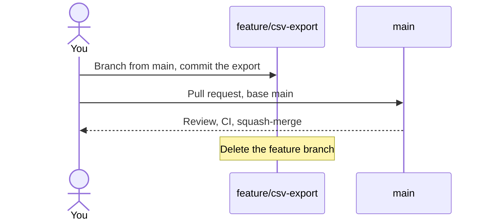

1. Fetch the latest remote state and create your branch from `origin/main` (using `origin/main` avoids branching from a stale local `main` or an old `develop` branch):
   ```bash
   git fetch origin
   git switch -c feature/csv-export origin/main
   ```
2. Make the change and run tests locally. Leave the version file (`package.json`, `.csproj`, etc.) and `CHANGELOG.md` alone. The DevLead sets the version when `release/1.5` is cut.
3. Stage, commit, and push your branch:
   ```bash
   git add -A
   git commit -m "Add CSV export of invoices"
   git push -u origin feature/csv-export
   ```
4. Open the pull request on GitHub:
   - Click **Compare & pull request** (or **Pull requests → New pull request**).
   - **base:** `main` · **compare:** `feature/csv-export`.
   - **Title:** `Add CSV export of invoices`.
   - **Body:** explain what changed and how a reviewer can verify it.
   - Click **Create pull request**.
5. Let CI finish and address review comments on this branch. If `main` has moved and GitHub offers **Update branch**, use it.
6. Once approved, squash-merge the pull request and delete `feature/csv-export`.

**You are done.** There is no tag, no backport, and no release branch. `main` now contains CSV export, and it will ship when the next `release/X.Y` branch is cut.

A bug fix for unreleased code (or in a repo that has no `release/X.Y` branches yet) follows the exact same steps: name the branch `fix/<short-name>`, merge to `main`, and stop.

### 5.2 Fix day — consumers are on 1.4, and 1.5 is still only on `main`

**At this moment.** `release/1.4` is the current line consumers run (latest tag `v1.4.0`). `main` holds unreleased `1.5` work. `release/1.3` still exists on the remote, but `1.3` only accepts security and critical fixes.

QA reports: an invoice with no tax code crashes the total calculation. You reproduce the crash on `v1.4.0` and on `main`. It is a normal product bug on the current line, so `1.4` gets a patch and `1.3` does not.

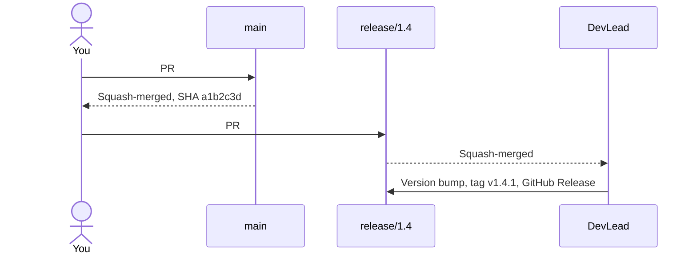

1. Fetch `origin` and create a fix branch from `origin/main`:
   ```bash
   git fetch origin
   git switch -c fix/null-tax origin/main
   ```
2. Write the fix against the code `main` has today:
   ```javascript
   function calculateTotal(invoice) {
     const tax = invoice.tax ?? "VAT0";
     return invoice.net * rates[tax];
   }
   ```
3. Commit, push, and open the pull request with **base:** `main` and title `Fix crash when tax code is null`.
4. Add the label `backport-to-release/1.4` to that pull request. The label records where the fix must be copied. It is a visible reminder, not an automated queue — you still open the backport yourself.
5. After the pull request is squash-merged into `main`, copy the **squash commit SHA** that landed on `main` (called `a1b2c3d` in this example):
   - **On GitHub:** look at the bottom of the merged pull request timeline (`merged commit a1b2c3d into main`) and click the copy icon next to that hash.
   - **From a terminal:**
     ```bash
     gh pr view 431 --json mergeCommit --jq .mergeCommit.oid
     ```
   - Always copy the commit SHA from `main`. The commits that used to be on your `fix/null-tax` branch are not on `main` after a squash merge.
6. **In the same sitting as the `main` merge:** open every required backport pull request (a draft is fine if CI is still running) before moving on to another task. A merged `main` fix with a `backport-to-release/X.Y` label and no open backport pull request is unfinished work.
7. Follow [the backport recipe](#6-the-backport-recipe) onto `release/1.4` (the `-x` flag appends `(cherry picked from commit a1b2c3d)` to the commit message so anyone reading `release/1.4` history can trace it back to `main`):
   ```bash
   git fetch origin
   git switch -c backport/null-tax-1.4 origin/release/1.4
   git cherry-pick -x a1b2c3d
   git push -u origin backport/null-tax-1.4
   ```
8. Open the backport pull request on GitHub with **base:** `release/1.4` and **compare:** `backport/null-tax-1.4`. Title: `[1.4] Fix crash when tax code is null`. Body:
   ```text
   Backport of #431.
   Cherry-pick of a1b2c3d.
   ```
9. Check the **Files changed** tab: it must show only the tax-code fix and nothing else. Wait for CI to pass, then get it reviewed and squash-merged.
10. Stop and let the DevLead know `#432` is merged. The DevLead bumps `1.4.0` → `1.4.1` on `release/1.4`, tags `v1.4.1`, and publishes the GitHub Release ([section 8.7](#87-version-bump-and-changelog) and [section 8.8](#88-tag-the-build-and-publish-the-github-release)).

`main` already has the fix, so `1.5` will include it automatically when `release/1.5` is cut. Never merge `release/1.4` back into `main`.

---

## 6. The backport recipe

Use this recipe every time a commit on `main` must also exist on a release branch. Repeat it once per target release branch, **newest release branch first**.

Always cherry-pick the **`main` commit SHA**, never the SHA of a previous backport. A backport onto `release/1.5` may contain conflict adaptations that only make sense on `1.5`.

### 6.1 Create the local backport branch and cherry-pick

```bash
git fetch origin
git switch -c backport/<short-name>-1.4 origin/release/1.4
git cherry-pick -x <sha-on-main>
```

Before pushing, verify what you are about to send and run the tests on that branch:

```bash
git log --oneline origin/release/1.4..HEAD
```

You should see **exactly one commit**. Run the project’s build/test command locally to confirm the cherry-picked code compiles and passes against the `1.4` codebase, then push:

```bash
git push -u origin backport/<short-name>-1.4
```

### 6.2 Open the pull request on GitHub

GitHub’s yellow push banner defaults to **base:** `main`. Always change **base** to the release branch before clicking **Create pull request**.

| Field | Value |
| --- | --- |
| **base** | `release/1.4` (the maintenance line you are patching) |
| **compare** | `backport/<short-name>-1.4` |
| **Title** | `[1.4] <same summary as the main pull request>` |
| **Body** | `Backport of #<main PR>. Cherry-pick of <sha-on-main>.` |

From a terminal, pass `--base` explicitly so `gh` does not target `main`:

```bash
gh pr create --base release/1.4 --head backport/null-tax-1.4 \
  --title "[1.4] Fix crash when tax code is null" \
  --body "Backport of #431. Cherry-pick of a1b2c3d."
```

### 6.3 Two mistakes that happen often (and how to fix them)

#### Mistake 1 — The pull request `base` dropdown was left on `main`

You branched from `origin/release/1.4` and cherry-picked properly, then clicked GitHub’s banner without changing the base branch. The pull request says `backport/null-tax-1.4` → `main`, and **Files changed** shows dozens of unrelated files. Merging it would dump `1.4` history onto `main` and leave `release/1.4` unpatched.

- **Fix:** Edit the pull request on GitHub, click the **base** dropdown, and switch it from `main` to `release/1.4` (or close the PR and open a new one with **base:** `release/1.4`). Your local branch does not need to be redone.

#### Mistake 2 — The backport branch was cut from `main` instead of `origin/release/1.4`

`git log --oneline origin/release/1.4..HEAD` lists dozens of commits instead of one, and **Files changed** shows every `1.5` feature committed since `1.4` was cut. Merging this would push unreleased `1.5` features into the `1.4` maintenance branch.

- **Fix:** Close the pull request immediately. Delete the bad branch (`git switch main && git branch -D backport/null-tax-1.4`), then repeat [6.1](#61-create-the-local-backport-branch-and-cherry-pick) starting from `origin/release/1.4`.

### 6.4 When `git cherry-pick` stops

| What Git says | What it means | What you do |
| --- | --- | --- |
| Clean output (new commit created) | The diff applied without conflicts | Run tests, push, and open the pull request. |
| `CONFLICT (content): Merge conflict in ...` | Surrounding lines on `release/X.Y` differ from `main` | Go to [section 8.5](#85-the-cherry-pick-conflicts) to resolve the conflict or re-implement the fix. |
| `The previous cherry-pick is now empty` | This fix is already on `release/X.Y` | Run `git cherry-pick --skip`, verify the code is already present, and delete your backport branch. |
| `commit ... is a merge but no -m option was given` | You passed a merge commit SHA instead of a squash or single commit SHA | Run `git cherry-pick --abort`, then cherry-pick the squash commit SHA (or each individual commit from oldest to newest). |

---

## 7. Find your situation

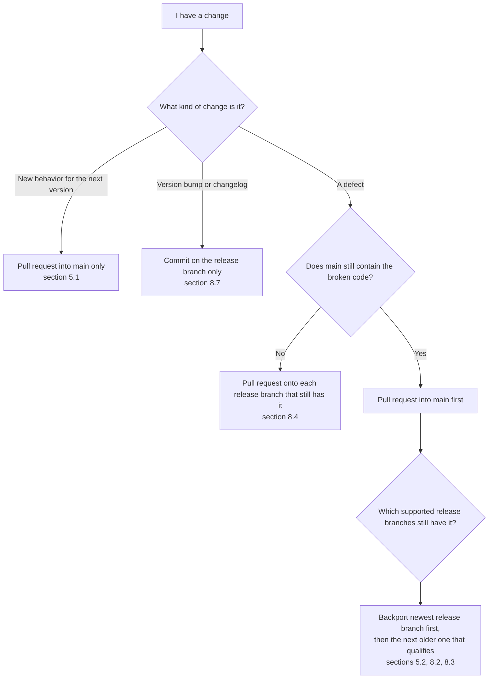

| You are looking at | Go to |
| --- | --- |
| A feature, or a fix when no `release/X.Y` branch has the bug yet | [5.1](#51-build-day-a-feature-or-unreleased-fix-on-main) |
| Consumers are on 1.4, 1.5 is only on `main`, and 1.4 has the bug | [5.2](#52-fix-day-consumers-are-on-14-and-15-is-still-only-on-main) |
| How a release candidate (`-rc.N`) fits for QA | [2.4](#24-pre-releases-release-candidates--for-qa) |
| A version on `main` is feature-complete and ready to freeze | [8.1](#81-cut-the-next-release-while-main-moves-on) |
| QA finds a bug on the frozen 1.5 candidate | [8.2](#82-a-bug-shows-up-while-that-release-is-freezing) |
| `v1.5.0` is already tagged, and a bug is found | [8.3](#83-a-bug-after-the-next-version-has-shipped) |
| The crashing function no longer exists on `main` | [8.4](#84-the-broken-code-is-gone-on-main) |
| `git cherry-pick` stopped with a conflict | [8.5](#85-the-cherry-pick-conflicts) |
| Someone already merged an emergency fix directly onto `release/1.4` | [8.6](#86-the-fix-was-committed-on-the-release-branch-first) |
| It is time to write `1.4.3` into the version file and changelog | [8.7](#87-version-bump-and-changelog) |
| It is time to tag `v1.4.3` and publish the GitHub Release | [8.8](#88-tag-the-build-and-publish-the-github-release) |
| 1.3 leaves the support window | [8.9](#89-the-line-is-out-of-support) |
| You must patch an out-of-support line, or a version tagged on `main` before `release/X.Y` existed | [8.10](#810-you-must-patch-an-out-of-support-or-legacy-tagged-version) |
| A ticket names a product/bundle version, and you are in one component repo | [8.11](#811-multi-component-releases-the-product-version-is-not-the-branch-name) |

### How to tell which moment your repository is in

Run `git fetch origin --tags`, list `origin/release/*` branches, and check the latest tags:

| Moment | What you see in Git | `main` | `release/1.5` | `release/1.4` | `release/1.3` |
| --- | --- | --- | --- | --- | --- |
| **0. Before first freeze** | Only `main` exists (no `release/X.Y` branches yet) | Initial version work | does not exist | does not exist | does not exist |
| **A. Building 1.5** | Newest branch is `release/1.4` (`v1.4.x` tagged); no `release/1.5` yet | 1.5 work | does not exist | current line (`v1.4.0` shipped) | previous line (security & critical only) |
| **B. Freezing 1.5** | `release/1.5` exists, but `v1.5.0` is **not** tagged yet (only `-rc` or untagged) | 1.6 work has started | freezing for QA | still the current consumer line | security & critical only |
| **C. 1.5 has shipped** | `release/1.5` has tag `v1.5.0` (or `v1.5.x`) | 1.6 work | current line (`v1.5.0` shipped) | previous line (security & critical only) | out of support (branch kept, no normal patches) |

---

## 8. Scenarios

### 8.1 Cut the next release while `main` moves on

**Who:** DevLead (PO decides the version is ready to cut). **Moment 0 or Moment A → Moment B.**  
**Also for QA:** how release candidates fit on this branch is explained in [section 2.4](#24-pre-releases-release-candidates--for-qa).

Previously, teams released directly from `main` (or merged `develop` into `main`). Under this guide, when `1.5` (or your very first release) is feature-complete on `main`, you create `release/1.5` from `main`. That gives QA a stable branch while `main` stays open for `1.6` work.

#### Example 1 — This repository has new commits and will ship a new minor tag (with a release candidate)

1. Create `release/1.5` from the current tip of `origin/main` and push it. Do this once:
   ```bash
   git fetch origin
   git switch -c release/1.5 origin/main
   git push -u origin release/1.5
   ```
2. On `release/1.5` only, open a pull request (**base:** `release/1.5`) that sets the version file to `1.5.0-rc.1` and updates the `1.5` changelog. Tag `v1.5.0-rc.1` after merge and mark it as a **pre-release** on GitHub. This commit is release-only; do not copy it to `main`.
3. Announce the cut: `1.6` feature work can now merge to `main`. Any bug fix needed for `1.5` must land on `main` first and be cherry-picked onto `release/1.5`.
4. QA tests the candidate. Bugs found during stabilization follow [section 8.2](#82-a-bug-shows-up-while-that-release-is-freezing).
5. When QA signs off, open a pull request on `release/1.5` bumping `1.5.0-rc.1` → `1.5.0`, merge it, tag `v1.5.0` on `release/1.5`, and publish the GitHub Release ([section 8.8](#88-tag-the-build-and-publish-the-github-release)).

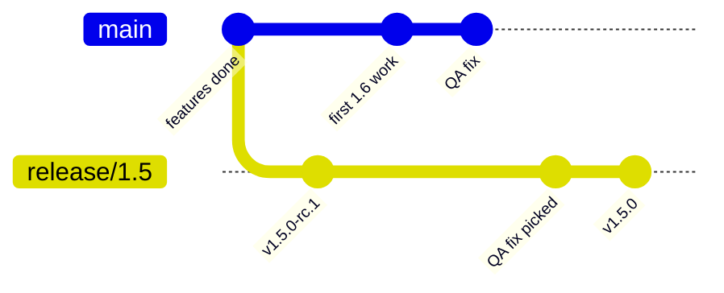

In that diagram, the QA fix lands on `main` first, and `QA fix picked` is its cherry-pick onto `release/1.5`. The `v1.5.0` version bump stays on the release branch, and tag `v1.5.0` points to that commit.

If your team freezes without release candidates, skip the `1.5.0-rc.1` bump: cut `release/1.5`, cherry-pick stabilization fixes, bump straight to `1.5.0` on `release/1.5`, and tag `v1.5.0`.

#### Example 2 — This component has not changed since its previous release

If a component repository has zero commits since its last shipped tag, **do not** cut a new `release/X.Y` branch, do not bump its version, and do not create an empty tag. Downstream consumers or product manifests simply continue pinning the existing tag. Cutting a branch “so every repository has a new version” creates maintenance lines with nothing in them.

### 8.2 A bug shows up while that release is freezing

**Moment B.** `release/1.5` is frozen in QA. `main` already has `1.6` commits. Consumers are still running `1.4`. A bug is found in the `1.5` candidate, and you verify the same bug still exists on `main`.

The fix still goes to `main` first, then is cherry-picked onto `release/1.5` so `1.6` cannot regress later. Whether `release/1.4` also gets the fix is a separate question: in Moment B, `1.4` is still the current consumer line, so if `1.4` has the broken code and consumers can hit it, backport to `release/1.4` as well (after `release/1.5`). If the bug was introduced by a new `1.5` feature that does not exist in `1.4`, stop after `release/1.5`.

#### Example 1 — `main` has not touched the affected file since the cut (clean cherry-pick)

The crash is a missing null check in `calculateTotal`. All `1.6` commits so far have been in other files.

1. Branch `fix/null-tax` from `origin/main`, open a pull request with **base:** `main`, and add labels `backport-to-release/1.5` and `backport-to-release/1.4` (assuming `1.4` also has the bug).
2. After squash-merge, copy the `main` commit SHA `a1b2c3d`.
3. Follow the backport recipe onto `release/1.5` first. Open pull request `[1.5] Fix crash when tax code is null` (**base:** `release/1.5`) and merge it.
4. Follow the backport recipe a second time from `a1b2c3d` onto `release/1.4`. Open pull request `[1.4] Fix crash when tax code is null` (**base:** `release/1.4`) and merge it.
5. The DevLead includes the `1.5` fix in the upcoming `v1.5.0` tag and ships `v1.4.1` on `release/1.4`.

Both backports cherry-pick `a1b2c3d` from `main`. Never cherry-pick the `1.5` backport commit onto `1.4`.

#### Example 2 — `main` already modified the same function for `1.6`, and the patch still applies

`main` renamed a helper two files away and added a log line inside `calculateTotal`, while the null check line itself is unchanged.

Repeat steps 1–4 above. If Git can match the surrounding lines, both cherry-picks apply cleanly. If either cherry-pick stops with a conflict because the `1.6` changes were too close to the fix, follow [section 8.5](#85-the-cherry-pick-conflicts).

**What not to do:** Never fix the bug only on `release/1.5` planning to “merge `release/1.5` back into `main` when QA finishes.” By the end of QA, merging `release/1.5` into `main` would drag `1.5.0-rc.1` version bumps, changelogs, and `1.5`-only workarounds into `main`.

### 8.3 A bug after the next version has shipped

**Moment C.** `v1.5.0` is now the current release. `main` is `1.6`. `release/1.4` is the previous minor (security and critical fixes only). `release/1.3` is still on the remote, out of support (no patches unless reopened by the DevLead with PO approval).

The bug: downloading a file whose name contains a slash saves it under a truncated name. It has a simple workaround and is neither a security issue nor a critical outage.

#### Example 1 — Reported on the current line (`1.5`)

1. Open a pull request into `main`: `Fix download names that contain a slash`. Squash-merged as `c0ffee1`.
2. Backport `c0ffee1` onto `release/1.5`. Title: `[1.5] Fix download names that contain a slash`.
3. Stop. Do not open a backport to `release/1.4` — `1.4` is the previous minor, and a normal bug does not qualify.
4. DevLead bumps `1.5` and tags `v1.5.1` on `release/1.5`.

#### Example 2 — The same normal bug is reported by a consumer still running `1.4`

You reproduce it on `v1.4.2` and confirm `release/1.5` and `main` also have the bug.

The backport target does **not** change based on who reported the ticket; `1.4` is outside the normal-bug window:

1. Land the fix on `main` (`c0ffee1`).
2. Backport `c0ffee1` onto `release/1.5` so the current supported version has the fix, and ship `v1.5.1`.
3. Leave `release/1.4` untouched. The consumer upgrades to the `1.5.1` line to receive the fix.

Opening a `1.4` backport “while you are here” breaks the support policy and creates an unscheduled `1.4` release train.

#### Example 3 — Security vulnerability or critical defect, so the previous minor (`1.4`) qualifies too

An expired authentication token is still accepted. Because this is a security defect, both the current minor (`1.5`) and the previous minor (`1.4`) qualify. `1.3` stays untouched.

1. Open a pull request into `main`. Add labels `backport-to-release/1.5` and `backport-to-release/1.4`. Squash-merged as `d00d1e1`.
2. Backport `d00d1e1` onto `release/1.5` **first** and merge it. The DevLead can tag `v1.5.1` as soon as this merges.
3. Backport `d00d1e1` onto `release/1.4` and merge it. The DevLead tags `v1.4.3` only after the `1.5` fix is in place, ensuring anyone upgrading from `1.4.3` to `1.5.1` keeps the security fix.
4. `main` already has the fix for `1.6`. No third backport.

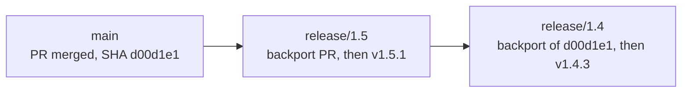

Even if the `1.5` cherry-pick required conflict resolution, start the `1.4` cherry-pick from `d00d1e1` on `main`.

### 8.4 The broken code is gone on `main`

**Moment C (applies in any moment when `main` no longer has the broken code).**

`1.4` formats legacy upload paths with `formatLegacyPath()`. Passing an empty path crashes the process and loses the upload. In `1.5`, the upload subsystem was rewritten and `formatLegacyPath()` was deleted. You check `main` and `release/1.5`: neither branch contains that function.

1. Note on the issue and pull request that `main` and `1.5` no longer contain `formatLegacyPath()`. There is no pull request to `main`.
2. Check which supported release branches still contain the function and qualify for the fix:
   - `release/1.5`: function does not exist. Skip.
   - `release/1.4`: function exists, and losing an upload crash is critical. Patch `release/1.4`.
3. Create a fix branch directly from `origin/release/1.4` (since there is no `main` commit to cherry-pick):
   ```bash
   git fetch origin
   git switch -c fix/legacy-path-1.4 origin/release/1.4
   ```
4. Write the fix on `fix/legacy-path-1.4`:
   ```javascript
   function formatLegacyPath(path) {
     if (!path) {
       return "";
     }
     return path.replace(/\\/g, "/");
   }
   ```
5. Commit, push, and open the pull request with **base:** `release/1.4`. Title: `[1.4] Fix crash on an empty legacy upload path`. Body: `Does not apply to main or 1.5; formatLegacyPath was removed in 1.5.`
6. If an out-of-support branch such as `release/1.3` also has the function, leave it alone unless the PO approves and the DevLead reopens `1.3`.

### 8.5 The cherry-pick conflicts

A cherry-pick conflict happens when the lines around your fix on `release/X.Y` differ from the lines around the fix on `main`. Your goal is always the same: **keep all of the release branch’s existing code except for the bug fix itself.**

When Git stops on a conflict, it marks the file like this:

- Everything between `<<<<<<< HEAD` and `=======` is what currently exists on your **release branch** (`HEAD`).
- Everything between `=======` and `>>>>>>> <sha>` is the incoming change from `main`.

#### Example 1 — Both branches edited the same line (resolve conflict markers)

You are cherry-picking `a1b2c3d` onto `release/1.4`. On `release/1.4`, someone had previously put `|| ""` on the same line. Git stops and writes conflict markers into `src/calculateTotal.js`:

```text
function calculateTotal(invoice) {
<<<<<<< HEAD
  const tax = invoice.tax || "";
=======
  const tax = invoice.tax ?? "VAT0";
>>>>>>> a1b2c3d (Fix crash when tax code is null)
  return invoice.net * rates[tax];
}
```

`|| ""` still crashes because `""` is not a valid key in `rates`. You want `invoice.tax ?? "VAT0"`.

1. Edit `src/calculateTotal.js` to remove the `<<<<<<<`, `=======`, and `>>>>>>>` markers and keep the fixed line:
   ```javascript
   function calculateTotal(invoice) {
     const tax = invoice.tax ?? "VAT0";
     return invoice.net * rates[tax];
   }
   ```
2. Run your tests locally to confirm `release/1.4` builds and passes.
3. Stage the resolved file and finish the cherry-pick:
   ```bash
   git add src/calculateTotal.js
   git cherry-pick --continue
   ```
4. Push `backport/null-tax-1.4` and open the pull request against `release/1.4` as normal.

#### Example 2 — `main` was refactored, so the `main` diff cannot compile on the older branch (re-implement the intent)

Suppose `a1b2c3d` on `main` looks like this because `1.5` renamed `invoice.tax` to `invoice.taxCode` and replaced `rates[tax]` with a `rate(tax)` function:

```javascript
function calculateTotal(invoice) {
  const tax = invoice.taxCode ?? "VAT0";
  return invoice.net * rate(tax);
}
```

`release/1.4` still uses `invoice.tax` and the `rates` object. Copying `invoice.taxCode` and `rate(tax)` onto `release/1.4` would break the build.

1. Abort the failed cherry-pick so your branch returns to a clean `origin/release/1.4` state:
   ```bash
   git cherry-pick --abort
   ```
2. Stay on `backport/null-tax-1.4` and write the `1.4` equivalent of the fix using `1.4`’s variable and table names:
   ```javascript
   function calculateTotal(invoice) {
     const tax = invoice.tax ?? "VAT0";
     return invoice.net * rates[tax];
   }
   ```
3. Run the tests locally, then commit and reference the `main` PR and SHA in the commit message:
   ```bash
   git add src/calculateTotal.js
   git commit -m "$(cat <<'EOF'
   Fix crash when tax code is null

   Backport of #431 (a1b2c3d).
   1.4 still uses invoice.tax and the rates table, so this applies the same intent as main to the 1.4 code.
   EOF
   )"
   git push -u origin backport/null-tax-1.4
   ```
4. Open the pull request with **base:** `release/1.4`. Reviewers verify that the behavior matches `#431` on `1.4`’s codebase.

If you are unsure what the older release branch expects during a conflict, stop and ask a teammate or the DevLead. Never guess and accidentally pull `1.5`/`1.6` refactors into `release/1.4`.

### 8.6 The fix was committed on the release branch first

**This is an emergency escape hatch, not the normal workflow.** Production is down on Friday. To ship an urgent patch immediately, a fix was branched from `release/1.4` and squash-merged directly into `release/1.4` as commit `b4c5d6e`. `main` does not have the fix yet.

You must **forward-port** that commit to `main` right away, or the next minor release will re-introduce the outage.

1. Create a forward-port branch from `origin/main` and cherry-pick the release-branch commit:
   ```bash
   git fetch origin
   git switch -c forwardport/null-tax origin/main
   git cherry-pick -x b4c5d6e
   git push -u origin forwardport/null-tax
   ```
2. Open a pull request with **base:** `main`. Title: `Fix crash when tax code is null`. Body: `Forward-port of #432 (b4c5d6e), which landed on release/1.4 first.`
3. If `main` has already refactored that area and the cherry-pick conflicts, abort (`git cherry-pick --abort`) and re-implement the fix on `main` (just like [Example 2 in 8.5](#85-the-cherry-pick-conflicts)), referencing `#432` in the commit message.
4. Once the forward-port merges to `main`, check if any newer release branch (such as `release/1.5`) was cut before your forward-port and also needs the fix. If so, cherry-pick the **new `main` SHA** onto `release/1.5`. Leave `release/1.4` alone — it already has the fix.

Still never `git merge release/1.4` into `main`; that would carry `1.4` version numbers and changelog commits onto `main`.

### 8.7 Version bump and changelog

**Who:** DevLead. All fix pull requests for this patch are already merged into `release/1.4`.

`release/1.4` now has the bug fixes on top of the previous tag `v1.4.2`, while the version file on `release/1.4` still reads `1.4.2`. Before tagging `v1.4.3`, update the version file and changelog on `release/1.4`.

1. Branch from `origin/release/1.4`:
   ```bash
   git fetch origin
   git switch -c release-prep/1.4.3 origin/release/1.4
   ```
2. Set the version to `1.4.3` in the repository’s version file (`package.json`, `.csproj`, `pyproject.toml`, etc.) and add the `1.4.3` entry to `CHANGELOG.md` referencing the merged backport pull requests (such as `#432`).
3. Commit, push, and open a pull request with **base:** `release/1.4` and title `Release 1.4.3`. Do **not** add a `backport-to-release/X.Y` label, and do **not** cherry-pick this commit to `main`.
4. Squash-merge the pull request into `release/1.4`.

What stays on the release branch vs what lives on both branches:

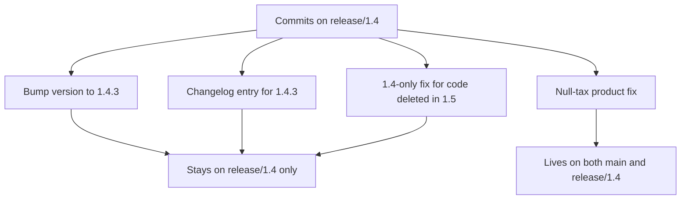

Why developers never include version bumps in their fix pull requests: if a fix commit on `main` also changed the version file to `1.4.3`, merging it would put `1.4.3` on `main` and cause version-file conflicts on every backport.

### 8.8 Tag the build and publish the GitHub Release

**Who:** DevLead. The `Release 1.4.3` pull request from [8.7](#87-version-bump-and-changelog) is merged into `release/1.4`.

1. Pull `release/1.4` and inspect the recent commits:
   ```bash
   git fetch origin
   git switch release/1.4
   git pull origin release/1.4
   git log --oneline -5
   ```
2. Confirm the version bump commit (`Release 1.4.3`) is at the top with the cherry-picked fix commit directly underneath it:
   ```text
   c7d8e9f Release 1.4.3
   b4c5d6e Fix crash when tax code is null (cherry picked from commit a1b2c3d)
   9aa11b2 Release 1.4.2
   ```
3. Create an annotated tag on that commit and push the tag to `origin`:
   ```bash
   git tag -a v1.4.3 -m "Release 1.4.3"
   git push origin v1.4.3
   ```
4. Publish the GitHub Release:
   - Go to **Releases → Draft a new release**.
   - **Choose a tag:** select the existing tag `v1.4.3` (never create a new tag pointing at `main`).
   - **Release title:** `v1.4.3` (or `1.4.3`, matching the repository’s convention).
   - Paste the `1.4.3` changelog notes (if using **Generate release notes**, verify the previous tag is `v1.4.2` so only `1.4.3` commits are listed).
   - Set the release flags using the examples below, then click **Publish release**.

#### Example 1 — `v1.4.3` is the highest version shipped so far (`1.5.0` is not out yet)

Check **Set as the latest release** so consumers and tooling see `v1.4.3` as the newest stable build.

#### Example 2 — `v1.5.0` is already published, and you are shipping `v1.4.3` for the older `1.4` line

Uncheck **Set as the latest release** so `v1.5.0` remains marked as `Latest` on GitHub. A patch on an older minor must never replace the current minor as `Latest`.

#### Example 3 — You are publishing a release candidate (`v1.5.0-rc.1`)

Check **Set as a pre-release** so it does not become `Latest` for production consumers.

**Tags are immutable.** If another bug is found tomorrow, never delete or force-push `v1.4.3` onto a new commit. Merge the new fix, bump to `1.4.4`, and tag `v1.4.4`.

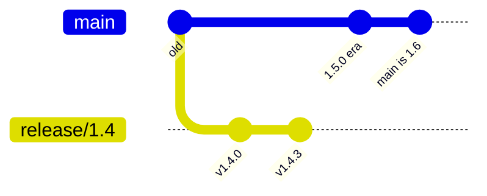

Tagging the tip of `main` as `v1.4.3` would ship `1.6` code disguised as a `1.4` patch. The tag `v1.4.3` always points to the `release/1.4` commit.

### 8.9 The line is out of support

**Moment C, one minor later.** `v1.6.0` has shipped. `1.6` is now the current minor, and `1.5` is the previous minor (security and critical fixes only). `1.4` has left the support window.

Do **not** delete `release/1.4`. Release branches remain on the remote permanently so commit history, branch comparisons, and any exceptional reopen stay straightforward. Leaving support means:

1. Stop opening normal or security backports onto `release/1.4` unless the PO approves an exception and the DevLead executes it ([section 8.10](#810-you-must-patch-an-out-of-support-or-legacy-tagged-version)).
2. Close or retarget any open routine pull requests that still target `release/1.4`.
3. Consumers reporting issues on `1.4` are directed to upgrade to a supported version (`1.5.x` or `1.6.x`).

Anyone who needs to inspect or build the exact code shipped in `v1.4.3` can always check out the tag directly:

```bash
git fetch origin --tags
git switch --detach v1.4.3
# return to main when done:
git switch main
```

### 8.10 You must patch an out-of-support or legacy-tagged version

Sometimes you must patch an older version (`1.2`) either because the PO approved a security exception for an out-of-support line, or because `v1.2.0` was tagged directly on `main` under the old workflow before the repository had `release/X.Y` branches.

#### Case 1 — `release/1.2` already exists on `origin`

1. If `main` still contains the vulnerable code, land the fix on `main` first and backport it to every currently supported line (`release/1.6`, `release/1.5`, …) newest first. An exception for `1.2` never skips newer versions.
2. Create a backport branch from `origin/release/1.2` (`backport/<short-name>-1.2`) and cherry-pick the `main` SHA, or re-implement the intent if `1.2` has diverged ([section 8.5](#85-the-cherry-pick-conflicts)).
3. Have the DevLead bump the version on `release/1.2` to `1.2.4`, merge, tag `v1.2.4`, and publish the GitHub Release **without** marking it as `Latest` ([Example 2 in 8.8](#88-tag-the-build-and-publish-the-github-release)).
4. Leave `release/1.2` in place and return it to “no patches” once the exception is complete.

#### Case 2 — `v1.2.0` was tagged directly on `main` under the old workflow (no `release/1.2` branch exists yet)

If `v1.2.0` was shipped before the repository adopted `release/X.Y` branches, `main` has already moved on to `1.3+` commits. Never tag today’s `main` as `v1.2.1`. Instead, the DevLead creates `release/1.2` from the `v1.2.0` tag:

1. DevLead creates and pushes `release/1.2` starting at tag `v1.2.0`:
   ```bash
   git fetch origin --tags
   git switch -c release/1.2 v1.2.0
   git push -u origin release/1.2
   ```
2. Land the fix on `main` first (if `main` still has the bug), then follow the normal backport recipe ([section 6](#6-the-backport-recipe)) targeting `release/1.2`.
3. Bump to `1.2.1` on `release/1.2`, tag `v1.2.1` on `release/1.2`, and publish the GitHub Release without marking it as `Latest`. Keep `release/1.2` on the remote from then on.

### 8.11 Multi-component releases: the product version is not the branch name

When multiple components (such as a frontend, an API gateway, and backend services) are delivered together as a numbered **product bundle**, consumers see the bundle version (for example, `Bundle 1.4.2` or `Bundle 1.5.0`).

Inside GitHub, each component repository still versions **itself** independently ([section 2.2](#22-independent-version-numbers-per-component)):

- A ticket filed against `Bundle 1.4` does **not** mean you look for `release/1.4` in every component repository.
- Instead, read the **release manifest** for that bundle to find which tag of your component it pins, then use `release/<component-major>.<component-minor>`.

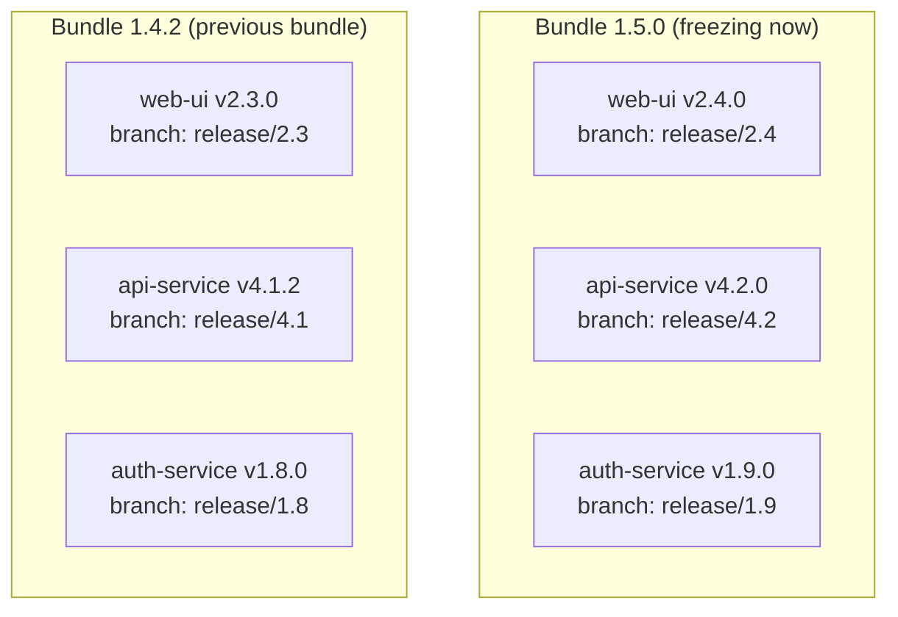

The support window from [section 3](#which-lines-still-receive-the-fix) applies to the **bundle minor** (`Bundle 1.5` vs `Bundle 1.4`). Once you know which bundles qualify for the fix, translate each qualifying bundle into the component branch listed in its manifest.

#### Example 1 — One component repository, two bundles (critical security fix in `api-service`)

Consumers running `Bundle 1.4.2` can authenticate with an expired token. The token check lives in `api-service`. `Bundle 1.5.0` is currently freezing in QA and has the same bug. Because this is a security defect, both `Bundle 1.5` and `Bundle 1.4` qualify.

First, look up `api-service` in both bundle manifests:

| Product bundle | Pinned `api-service` tag | Branch in `api-service` |
| --- | --- | --- |
| `Bundle 1.5.0` (freezing, not tagged yet) | `v4.2.0` (upcoming) | `release/4.2` |
| `Bundle 1.4.2` (current shipped bundle) | `v4.1.2` | `release/4.1` |

Now work inside the `api-service` repository using its own version numbers:

1. Open a pull request into `api-service` `main`. Add labels `backport-to-release/4.2` and `backport-to-release/4.1`. Squash-merged as `e1e1e1e`.
2. Backport `e1e1e1e` onto `release/4.2` first (`[4.2] Reject expired auth tokens`). Because `v4.2.0` is not tagged yet, this fix will be included when `v4.2.0` is tagged.
3. Backport `e1e1e1e` onto `release/4.1` (`[4.1] Reject expired auth tokens`). The DevLead bumps `api-service` on `release/4.1` to `4.1.3` and tags `v4.1.3`.
4. Leave `web-ui`, `auth-service`, and all other unchanged component repositories untouched.

The DevLead then publishes patch manifest `Bundle 1.4.3`, bumping only `api-service` and repeating every other component’s existing tag:

```yaml
bundle: 1.4.3
components:
  web-ui: v2.3.0          # unchanged
  api-service: v4.1.3     # patched
  auth-service: v1.8.0    # unchanged
  billing-service: v3.0.1 # unchanged
```

#### Example 2 — Two component repositories, one bundle (normal QA bug on the `1.5` train)

During QA of `Bundle 1.5.0`, a filename-handling bug is found that spans `api-service` and `auth-service`. It is a normal bug, so only `Bundle 1.5` gets the fix (`Bundle 1.4` does not).

- In `auth-service`:
  1. Open a pull request into `auth-service` `main` and merge it.
  2. Backport onto `release/1.9` only (the branch `Bundle 1.5.0` pins). Do not backport to `release/1.8`.
- In `api-service` (in parallel):
  1. Open a pull request into `api-service` `main` and merge it.
  2. Backport onto `release/4.2` only. Do not backport to `release/4.1`.

`web-ui` and `billing-service` did not change, so they receive no pull requests and keep their existing tags in the `Bundle 1.5.0` manifest:

```yaml
bundle: 1.5.0
components:
  web-ui: v2.4.0
  api-service: v4.2.0
  auth-service: v1.9.0
  billing-service: v3.0.1 # unchanged from previous bundle
```

---

## 9. Reviewing a pull request

Use this checklist before approving any pull request.

#### A pull request into `main`

- **Base branch** is `main` (never a legacy `develop` branch).
- **Diff** contains only the feature or bug fix described in the title/body.
- **Version file and changelog** are untouched (unless the DevLead is deliberately setting a development version on `main`).
- If this is a fix that also affects one or more supported release lines, it has a `backport-to-release/X.Y` label for each qualifying line.
- If a `backport-to-release/X.Y` label is present, confirm the author has linked the backport pull request(s) or is opening them in the same sitting.

#### A backport pull request into `release/X.Y`

- **Base branch** is `release/X.Y` (never `main`), and the title starts with `[X.Y]`.
- That `X.Y` line actually qualifies for this fix (within the support window in [section 3](#which-lines-still-receive-the-fix), or explicitly reopened by the DevLead with PO approval).
- **Commits tab** shows a single cherry-picked commit (`cherry picked from commit <sha>`), or a single re-implementation commit whose message cites the original `main` PR and SHA.
- **Files changed tab** touches only the files needed for the fix. If it shows dozens of unrelated files across the repository, the branch was accidentally cut from `main` — request that it be closed and recreated from `origin/release/X.Y`.
- **Version file and changelog** are untouched. Version bumps belong in the DevLead’s separate `Release X.Y.Z` pull request.
- **CI** is green on the `release/X.Y` branch.

#### A forward-port pull request into `main`

- **Base branch** is `main`.
- **Body** cites the `release/X.Y` pull request and commit SHA that landed first.
- **Diff** does not include `release/X.Y`’s version bump or changelog entry.

---

## 10. Cheat sheet

| Situation | First pull request | Then | Tag |
| --- | --- | --- | --- |
| Feature for the next version | `main` | Stop | Later, when that minor is cut |
| Bug fix when no `release/X.Y` has the bug | `main` | Stop | Later, when that minor is cut |
| Bug fix for the current line, next minor not cut yet | `main` | Backport to current `release/X.Y` | `vX.Y.(Z+1)` on `release/X.Y` |
| Cut the next minor release | Cut `release/X.Y` from `main` | Bump version on `release/X.Y` only; further fixes land on `main` then cherry-pick | `vX.Y.0` (or `vX.Y.0-rc.1` first) on `release/X.Y` |
| Bug found during QA freeze | `main` | Backport to freezing `release/X.Y` first, then older qualifying line | Included in each patched line’s next tag |
| Normal bug after a newer minor has shipped | `main` | Backport **only** to the current minor’s `release/X.Y` | `vX.Y.(Z+1)` on current line; older lines upgrade |
| Security or critical bug | `main` | Backport to current `release/X.Y`, then previous minor’s `release/X.Y` (newest first) | Patch tag on each patched line |
| Broken code already deleted on `main` | Affected `release/X.Y` directly | Any older qualifying `release/X.Y` that still has the broken code | Patch tag on those lines only |
| Urgent fix merged on `release/X.Y` first | Forward-port to `main` | Backport the new `main` SHA to any newer `release/X.Y` that missed it | Patch tag on lines that need a ship |
| Component has no changes in this release | None | Do not cut a branch, bump version, or create a tag | Keep pinning the previous tag |
| Line reaches end of support | None | Keep `release/X.Y` on remote; stop opening backports | Keep all `vX.Y.Z` tags |
| Patch an out-of-support line, or a version tagged on `main` under the old workflow | `main` (if bug still exists there) | Cut `release/X.Y` from `vX.Y.0` if branch does not exist yet; backport onto `release/X.Y` | `vX.Y.(Z+1)` (do **not** mark as `Latest`) |

### Commands you will run day to day

```bash
# 1. See which release branches and tags exist (then check the support window)
git fetch origin --tags
git branch -r | grep 'origin/release/'

# 2. Start a feature or a bug fix on main
git fetch origin
git switch -c fix/null-tax origin/main

# 3. Get the squash commit SHA after your main PR (#431) merges
gh pr view 431 --json mergeCommit --jq .mergeCommit.oid

# 4. Backport that main commit onto a release branch
git fetch origin
git switch -c backport/null-tax-1.4 origin/release/1.4
git cherry-pick -x <sha-on-main>

# 5. Verify your backport branch has only ONE commit before pushing
git log --oneline origin/release/1.4..HEAD

# 6. Push and open the backport PR against the release branch (NOT main)
git push -u origin backport/null-tax-1.4
gh pr create --base release/1.4 --head backport/null-tax-1.4 \
  --title "[1.4] Fix crash when tax code is null" \
  --body "Backport of #431. Cherry-pick of <sha-on-main>."

# 7. Forward-port an emergency release-branch commit back to main
git fetch origin
git switch -c forwardport/null-tax origin/main
git cherry-pick -x <sha-on-release-branch>
```
